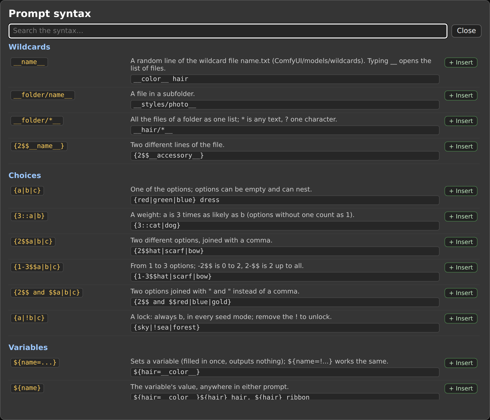
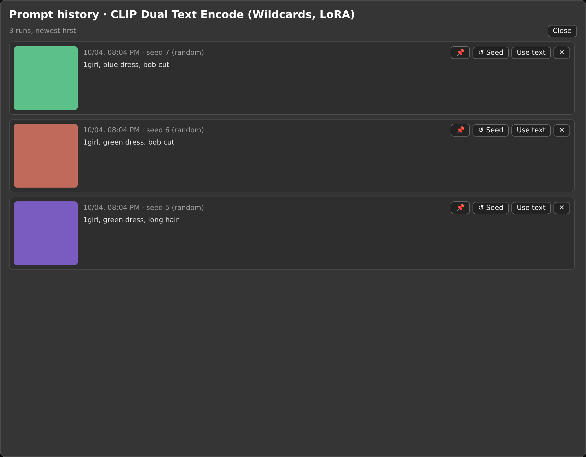
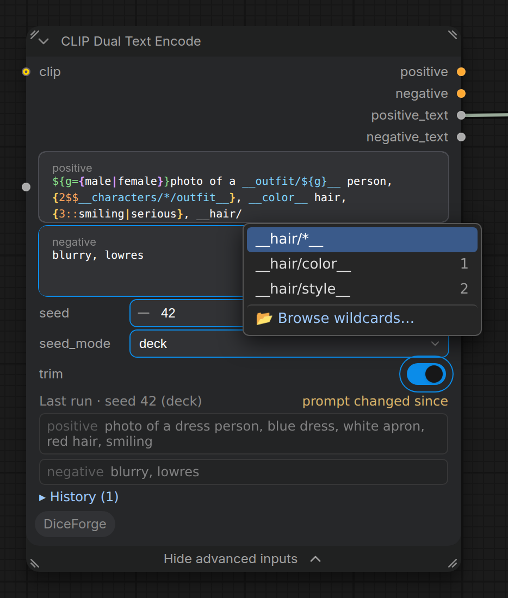
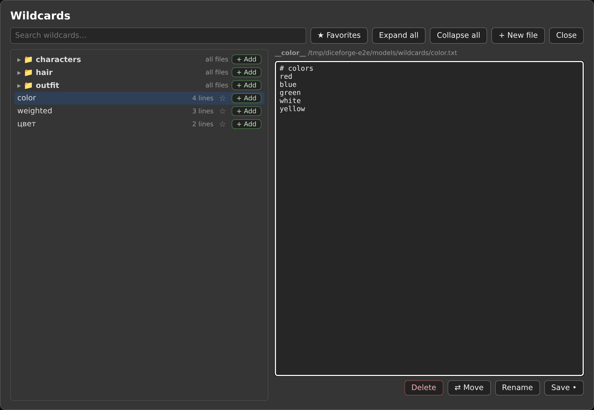
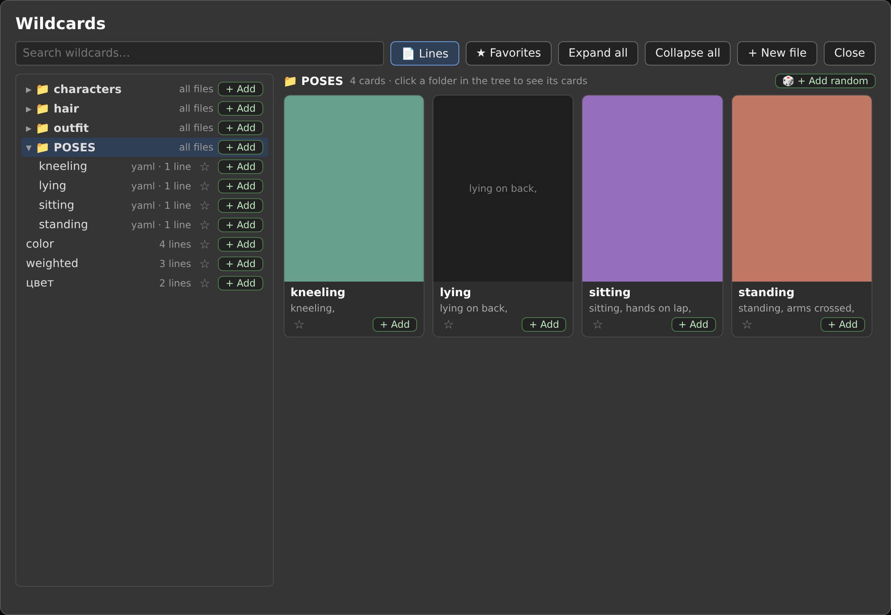

### CLIP Dual Text Encode (Wildcards, LoRA)


Node id: `DiceForgeCLIPDualTextEncode`.

Works like two core *CLIP Text Encode (Prompt)* nodes sharing one CLIP model: each prompt is encoded exactly the same way, so the conditioning is identical to the core node's for the same text. On top of that, both prompts support wildcards and `{a|b}` choices, picked from a seed.

Its right-click menu has the prompt tools: **📖 Syntax guide** (every piece of the syntax below with an example; **+ Insert** puts the example where the cursor was, a click copies it), **🕘 Prompt history**, **🎲 Wildcard Browser**, **✂ Selection → new wildcard…** (the part of a prompt you selected becomes a new wildcard file's first line, and `__name__` takes its place; a name already taken gets it as one more line), **🎴 LoRA Browser** (to insert trigger words), **🏷 Tag autocomplete** (download tag lists), **🏷 Tag Browser** and **🎨 Prompt styles**. The windows open where you closed them: the Wildcard Browser with its search, ★ Favorites, the file you had open (with its unsaved changes, as long as the file didn't change meanwhile) and where it was scrolled; the Tag Browser with its search, type, order and where it was scrolled; the syntax guide with its search; the model browsers (below) with their search, tag filter, order and where they were scrolled. Kept in this browser, also after a reload. Each of these windows can be resized by dragging its bottom-right corner, and keeps its size; a double-click on its title gives back the default size. In each of them, **?** (or **⌨**) shows its keys.



#### Inputs

| Input | Section | Description |
|---|---|---|
| `clip` | main | The CLIP model used for encoding both prompts. Optional: without it the node only fills in the prompts, for the text outputs. |
| `model` | main | Optional: the model, for [`<lora:...>` in the prompts](https://github.com/DeduxOnline/ComfyUI-DiceForge#loras-in-the-prompt). Passed through to the `model` output when the prompts have none. |
| `positive` | main | The positive prompt (top text field): what the image should contain. |
| `negative` | Advanced | The negative prompt: what the image should avoid. Under *Show advanced inputs*, since it is usually set once; it is used and saved the same when hidden. |
| `seed` | Advanced | Seed for choices and wildcards. The same seed always gives the same prompts, in every mode. By default it is randomized after each run (*control after generate*); set it to *fixed* to repeat a result. |
| `seed_mode` | Advanced | How choices and wildcards change from run to run: `random` (default), `deck`, `shuffle`, `balanced`, `combinations` or `mutate`. See [Seed modes](https://github.com/DeduxOnline/ComfyUI-DiceForge#seed-modes). |
| `trim` | Advanced | On by default: removes extra spaces from both prompts, at the start and end of lines, double spaces, spaces before `, . ; : ! ? )` and after `(`, and extra empty lines (`  a  girl , ( smile :1.1 )` becomes `a girl, (smile:1.1)`). Only spaces change. |

#### Outputs

| Output | Description |
|---|---|
| `model` | The model with the prompts' `<lora:...>` LoRAs. Connect it to KSampler instead of the loader's model. |
| `positive` | Conditioning from the positive prompt. |
| `negative` | Conditioning from the negative prompt. |
| `positive_text` | The positive prompt as encoded, with choices, wildcards and variables filled in. |
| `negative_text` | The negative prompt as encoded, with choices, wildcards and variables filled in. |

The text outputs carry the prompt that was actually used, for example to show it with a preview node, put it in a file name, or feed a text encoder for other models (Flux, SD3, video models): leave `clip` unconnected and the node only fills in the prompts, with every seed mode.

When choices or wildcards change a prompt, the filled-in prompts and the seed are printed to the ComfyUI console.

#### Prompt syntax

| Syntax | Result |
|---|---|
| `__name__` | A random line from the wildcard file `name.txt`. |
| `__folder/name__` | A random line from `folder/name.txt` inside a wildcards folder. |
| `__hair/*__` | A random line from all the files in the `hair` folder and its subfolders, as if they were one file. `*` matches any text (including `/`), `?` one character: `__*/color__` uses every `color.txt` in a subfolder, `__style_*__` every file starting with `style_`. |
| `{red\|green\|blue}` | One of the options at random. Options can be empty (`{big\|}`) and can nest (`{a\|{b\|c}}`). |
| `{3::cat\|dog}` | Weighted choice: `cat` is 3 times as likely as `dog`. Options without a weight count as 1. |
| `{2$$a\|b\|c}` | Two different options, joined with `, `. |
| `{1-3$$a\|b\|c}` | From 1 to 3 different options. `-2$$` means 0 to 2, and `2-$$` means 2 up to all of them. |
| `{2$$ and $$a\|b\|c}` | Two options joined with ` and ` instead of `, `. The separator has no braces, so a multi-pick can also be the first option: `{2$${2$$a\|b}\|c\|d}`. |
| `{2$$__color__}` | Two different lines of `color.txt` (sd-dynamic-prompts style): a multi-pick whose only option is a wildcard picks from its lines. All the forms above work: `{1-3$$ and $$__accessory__}`, `{2$$__hair/*__}`. |
| `${hair=__color__}` | Sets the variable `hair`: its value is filled in once (choices and wildcards included) and outputs nothing. `${hair=!...}` (sd-dynamic-prompts style) works the same. |
| `${hair}` | The value of `hair`, anywhere in the positive or negative prompt: `${hair=__color__}${hair} hair, ${hair} ribbon` gives `red hair, red ribbon`. |
| `__outfit/${g}__` | A variable in a wildcard name: `${g={male\|female}}1person, __outfit/${g}__` reads `outfit/male.txt` or `outfit/female.txt`, whichever `g` got, so related parts of a prompt match. The variable can be set anywhere in the same prompt, or in the positive prompt for the negative. Not available in the `combinations` seed mode (it cannot know in advance which file will be read). |
| `{sky\|!sea\|forest}` | Locked choice: always `sea`, in every seed mode, without rewriting the prompt. Remove the `!` to unlock. With several `!` options all of them are used. In `random` and `deck` the other choices keep their picks for the same seed; in `combinations` a locked choice counts once; in `mutate` it is never the one that changes. `3::!sea` works like `!3::sea`. |
| `// ...`, `/* ... */` | Comments, removed before encoding. |

To write `{`, `}` or `|` literally, put a backslash before it: `\{`, `\}`, `\|`. An option that should start with a real `!` is written `\!`.

Weights and counts can be combined, for example `{2$$3::hat|scarf|bow}`. Plain `{a|b}` choices give the same result for the same seed as before these options were added.

Commas left behind by empty options are cleaned up: `a girl, {|cat}, smile` becomes `a girl, smile` rather than `a girl, , smile`. Doubled commas, spaces before commas and commas at the start or end of the prompt are removed too.

Variables are shared by both prompts and can be set in a wildcard file line too (for example a character file that sets `${hair=...}`). A variable can be used before or after it is set; if it is set twice, the last value is used everywhere. Using a variable that is never set stops the run with an error that names it.

Prompt weights such as `(word:1.2)` and embeddings work as in the core node.

Lines picked from a wildcard file can themselves contain wildcards and `{a|b}` choices; they are filled in too, up to 50 levels deep (a wildcard that includes itself stops with an error instead of looping forever).

#### Seed modes

In `random` mode every pick is independent, so `blue sky` can come up twice in a row while other options wait. `deck` and `shuffle` go through all the options before repeating one; `balanced` makes repeats rare instead of impossible. `combinations` goes through every combination of the whole prompt, and `mutate` changes one choice at a time.

| Mode | How it works | Seed |
|---|---|---|
| `random` | Every pick is random. Same as before seed modes existed. | The same seed gives the same prompt. |
| `deck` | Like dealing cards: the seed is a position in a shuffled deck of the options. Set *control after generate* to *increment*: each run takes the next card, every option comes once per round, then the deck is reshuffled (never starting with the option that just came). Rounds start at seeds that are multiples of the number of options (0, 5, 10… for 5 options), so start from such a seed (for example 0) to get no repeats from the first run. Options inside a picked option (`{cat {small\|big}\|dog}`, lines of a wildcard inside a wildcard) also take turns. | The same seed gives the same prompt, so a good result can be repeated. |
| `shuffle` | Like shuffle in a music player: the node remembers which options were already used and picks from the rest; when all were used, it starts over. Works with *increment* and with *randomize*: every new seed takes the next option. The memory is kept in a file, so it continues after a restart. | A seed that came before gives the same prompt again (from the memory file), and doesn't move the shuffle on. *fixed* gives the same prompt every run. |
| `balanced` | Like the pseudo-random distribution in games: an option that just came up gets a low chance, and the longer an option is missed, the higher its chance grows. Repeats are rare but possible (with 5 options: about 4% in a row instead of 20% in `random`, and no option waits more than about 13 runs instead of 40+). In the long run every option comes exactly as often as its weight says (`{3::cat\|dog}`: 75% / 25%). Works with *increment* and *randomize*; the memory is kept in a file, as in `shuffle`. | The same seed gives the same prompt again, as in `shuffle`. |
| `combinations` | The seed numbers every combination of all the choices, wildcards and variables in both prompts, so seeds 0, 1, 2… go through each combination exactly once, then start over (the seed is taken modulo the number of combinations). For example `{sky\|sea}, __color__ hair` with 3 colors has 6 combinations: seeds 0–5. The first choice changes fastest. The console shows the number, for example *combination 4 of 6*. Weights only matter as `0::` (never used); `{2$$a\|b\|c}` counts every set of 2 options once. Good for trying every character in every style: set *control after generate* to *increment* and start from 0. | The same seed gives the same prompt. |
| `mutate` | The first run picks at random; every next run keeps the last prompt and changes just one choice to a different option (a choice inside a newly picked option is picked fresh). Good for exploring variations of a result you like: keep running, and every image differs from the one before in one detail. The node remembers the last picks for these prompts in the memory file, so it continues after a restart; editing the prompt starts from a fresh random pick. Each new seed is a new mutation. | The same seed gives the same prompt again, as in `shuffle`. |

In `deck` and `shuffle` modes:

- The same wildcard or choice used more than once in a prompt gives different options: `__color__ hair, __color__ eyes` never gives `red hair, red eyes` (unless the file has only one line).
- A weight is the number of times the option comes per round: `{3::cat|dog}` gives `cat` 3 times and `dog` once. Weights are rounded to whole numbers, at least 1.
- `{2$$a|b|c}` takes the next options in the order, still without duplicates in one pick.

#### Memory file

`shuffle`, `balanced` and `mutate` remember what came up before in `ComfyUI/user/DiceForge/seed_memory.sqlite`, so they continue where they stopped after ComfyUI restarts, and the memory doesn't take RAM: only the list being picked from is read, when it is picked from.

- One entry per list of options (a `{a|b}` choice or a wildcard file) and mode, plus one per prompt for `mutate`. Editing a list or a wildcard file starts that list over.
- For every seed, where each list was when that seed came. The same seed then picks from there again, with its choices drawn from the seed, so it gives the same result, and the list doesn't move on. A seed is made again this way as long as the file remembers it: deleting the file, or a seed forgotten among the oldest entries, picks from where the list is now.
- `shuffle` stores just its place in the shuffled order, a few bytes even for a wildcard file with thousands of lines. `balanced` stores a number per option (about 7 bytes each).
- The least recently used entries are forgotten past 100,000 entries.
- To start everything over, delete the file (ComfyUI can stay running).

#### Wildcard files

- Put wildcard files in `ComfyUI/models/wildcards`, for example `ComfyUI/models/wildcards/color.txt`. Subfolders work too: `ComfyUI/models/wildcards/styles/photo.txt` is `__styles/photo__`.
- More folders can be added with a `wildcards:` entry in ComfyUI's `extra_model_paths.yaml`.
- Names can have single spaces inside, like file names: `hair color.txt` is `__hair color__`. A `__` followed or preceded by a space (`__ text__`) stays plain text.
- One option per line. Empty lines and lines starting with `#` are skipped. Files are read as UTF-8, with or without the BOM that Windows Notepad adds. A file in another encoding stops the run with an error that names it (save it as UTF-8), and the Wildcard Browser marks it with ⚠.
- A line can have a weight, as in choices: `3::blonde hair` comes 3 times as often as a line without a weight, `0::` turns a line off. In `deck` and `shuffle` a weight is the number of copies of the line in the deck (a deck holds at most 10000 cards: bigger weights are scaled down to fit, and every line keeps at least one); `combinations` counts every line once (except `0::`).
- **YAML files** (the format of Dynamic Prompts and Impact Pack wildcard packs, `.yaml` or `.yml`) work too: nested keys are the folders and each list is one wildcard. See the example below. In a subfolder of the wildcards folder, the subfolder comes first (`styles/pack.yaml` with a `photo` key is `__styles/photo__`). A `.txt` file hides a yaml key with the same name. Lines are text as written: `yes`, `no`, `12:30` or `0123` stay as they are (plain YAML would turn them into true, false or numbers); only `~`, `null` and empty items are skipped. A yaml file that cannot be read (invalid YAML, not UTF-8, aliases like `*name`, or keys nested more than 50 levels deep) is skipped with a warning in the console. In the Wildcard Browser a yaml file is one row of the tree, shown whole, and its wildcards are cards too (see below).
- A missing or empty wildcard file stops the run with an error that names the file and the wildcards folders.
- Wildcards and variables can nest up to 50 levels, and the prompts of a run can fill in up to 100,000 choices, wildcards and variables and come out up to a million characters long. More than that (a wildcard that uses another one twice, which uses another one twice...) stops the run with an error instead of running for hours.
- The node runs again when a wildcard file changes, even if the prompts and the seed stay the same.
- A `*` or `?` name (`__hair/*__`) joins the lines of every file it matches, in name order, so all seed modes (deck, shuffle, combinations…) treat them as one list. Empty files among them are skipped; a name that matches nothing stops the run with an error.

#### LoRAs in the prompt

As in A1111: `<lora:name:weight>` in either prompt puts that LoRA on the model and on the CLIP before the prompts are encoded. `<lora:name:0.8:0.5>` gives the model and the CLIP different weights, `<lora:name>` is weight 1, and `<lyco:...>` works the same. The name is the file name, with or without its folder and extension (`ink`, `style/ink`, `style/ink.safetensors`).

- Connect the loader's `model` to the node's `model` input and the node's `model` output to KSampler, and the loader's CLIP to `clip`, as usual.
- The tags are read after choices and wildcards are filled in, so they can be random too: `{<lora:ink:0.8>|<lora:glow:0.7>|}`, or a wildcard file of LoRA tags.
- The tags are taken out of the text (and the commas around them tidied); the preview under the node lists the LoRAs of the run.
- A name with no LoRA file stops the run and says which. Typing `<lora:` in a prompt field suggests the LoRA files.

#### Syntax highlighting

The prompt fields color the syntax as you type: `__wildcards__` (red with a wavy line when no wildcard file has that name; hover the field to see which), the braces and `|` of `{a|b}` choices (one color per nesting level, white on red when a brace is never closed or closes nothing), counts `2$$`, weights `3::`, locks `!`, `${variables}`, `//` and `/* */` comments, `\{` escapes, `(word:1.2)` weights, `embedding:` names and `<lora:...>` tags. Only the colors change: typing, the caret, selecting and the `__` autocomplete work as before. The Wildcard Browser's editor colors its files the same way. Turn it off in ComfyUI's settings: *DiceForge → Prompts → Highlight the prompt syntax in CLIP Dual Text Encode and the Wildcard Browser*.

#### Preview of the prompts as encoded

After each run the node shows, under its inputs, the **positive** prompt as it was encoded (and the **negative** one when the node's advanced inputs are shown, where its field is; always in the classic canvas): choices, wildcards and variables filled in, with the seed and seed mode they came from (and *combination N of M* in `combinations`). Click a prompt to copy it. The preview is kept with the workflow, so it is still there after a reload and in a workflow loaded from an image; when you change a prompt it is dimmed and marked *prompt changed since* until the next run. It also updates when the node comes from ComfyUI's cache.

**🕘 Prompt history** in the node's right-click menu opens a window with the last 20 runs' prompts, newest first, with the time, seed and mode, and **the images each run made**: the first image of every Save Image, Preview Image, VAE Decode + Save… of the workflow in that run (up to 4; click one to open it full size). A preview image is kept by ComfyUI only until it restarts; saved ones stay. A run with the same prompts and seed as the newest one is not added again (its new images join that entry). For each entry:



- **↺ Seed** puts back that run's prompts, seed and seed mode, and sets *control after generate* to *fixed*: the next run gives exactly those prompts again. In every mode a seed gives the same prompts (as long as the wildcard files are the same and, in `shuffle`, `balanced` and `mutate`, the memory file remembers the seed).
- **Use text** puts the prompts as encoded in the fields: every choice and wildcard fixed as in that run.
- **📌** pins it: pinned entries stay past the 20. **✕** removes it.

The history (with the images' file names) is kept in the node, with the workflow.

#### Autocomplete and the Wildcard Browser





- **Autocomplete:** type `__` in the positive or negative field and a list of the wildcard files (with their number of lines) and folders (`folder/*`) opens at the cursor. Keep typing to filter it; ↑/↓ to move, Enter or Tab to insert, Esc to close. The last entry, *📂 Browse wildcards…*, opens the browser.
- **Wildcard Browser:** right-click the node → *🎲 Wildcard Browser*. It shows the wildcard folders as a tree, with the number of lines of each file and its first lines as a tooltip, and a search box. Folders start closed: click a folder's name to open or close it, or use **Expand all** and **Collapse all**. The browser remembers which folders are open; a search shows every match with its folders open, and opening a file opens its folders.
  - **+ Add** next to a file inserts `__name__`, next to a folder `__folder/*__`, where the cursor was last in the node's positive or negative field (at the end of the positive prompt if you have not clicked in one yet). Commas are added when the name would touch other text.
  - **+ New file** creates a file (`hair/color` makes the `hair` folder too) in the first wildcards folder. A name that is already taken is refused, so an existing file is never emptied.
  - Click a file name to open it in the editor on the right, change its lines and **Save** (or Ctrl+S). *Save •* means there are unsaved changes; opening another file asks first whether to drop them. As in a code editor, every line has its number on the left and a thin line under it, the line with the caret is highlighted, and the syntax is colored as in the prompt fields (with `#` comment lines and `3::` line weights); long lines scroll sideways instead of wrapping, so a number always belongs to one option.
  - The editor has the same autocomplete as the prompt fields: `__` lists the wildcards, `<lora:` the LoRA files, and a word the most used Danbooru/e621 tags (with the tag lists downloaded). ↑ ↓ pick, Enter or Tab put it in, Escape closes the list (a second Escape closes the browser).
  - **+** next to a line's number (shown when the mouse is over a line) puts that line in the node's prompt, where the cursor was last, without its `3::` weight.
  - The search finds wildcards by their lines too: a wildcard whose name doesn't match but one of its lines does is listed with that line in blue.
  - **⇪ Import zip** (or a zip dropped on the window) unpacks a zip of wildcards, a card pack for example, into the wildcards folder with its paths: txt and yaml files and their pictures. Files already there are kept as they are; anything else (any path that would leave the folder, a damaged file, a folder name ending in a space or dot) is left out. A zip may be up to 512 MB, with up to 5000 files and 1 GB unpacked.
  - **Right-click** a file or a folder (or its **⋯**) for everything else: open, + Add, **🎲 Preview picks**, ★, rename, move, → yaml / → txt, ⇩ Export zip, a new file in the folder, delete. **🎲 Preview picks** shows what runs would put in for a wildcard or a folder's `__folder/*__` (5 random picks, filled in as the node does: weights, choices, nested wildcards), each with **+ Add** to use that text; **🎲 Again** for others.
  - **⚠** on a row: the file uses wildcards that don't exist (the tooltip names them; the editor underlines them in red). **⚠ Broken (n)** in the toolbar shows only such files.
  - **🔁 Replace** finds a text in every wildcard, txt files and yaml keys, and replaces it, after a preview of each change. After a rename or a move, the message offers **🔁 Update the wildcard files that use it**: the old `__name__` replaced with the new one.
  - **⇦ Prompt as a line** (under the editor, or in a file's menu) adds the node's prompt (the one the cursor was last in) to the open file as a new line: a prompt you like becomes one more option of the wildcard. Its line breaks become spaces, and a line the file already has isn't added twice; **Save** keeps it. Only for a txt file: the button is off while a yaml file is open.
  - **🧹 Remove duplicates and empty lines** and **🔤 Sort lines A→Z** (in a file's menu) clean the file up in the editor; the comments at its top stay, a line's `3::` weight is left aside when sorting. **Save** keeps it.
  - **The keyboard**: **/** jumps to the search, **↑ ↓** pick a file, **Enter** puts it in the prompt, **Shift+Enter** opens it, **F2** renames it, **Delete** deletes it (↶ Undo), the menu key or **Shift+F10** opens its menu.
  - **⇩ Export zip** downloads every wildcard as a zip, **⇩ Export zip** in a folder's menu that folder (with a yaml card pack's yaml file next to it, `POSES.yaml` with `POSES/`): to share a card pack or keep a copy. Import zip takes it back.
  - **☆** next to a file makes it a favorite (★); **★ Favorites** in the toolbar shows only the favorites, in open folders. In the `__` autocomplete, favorites come first (after the names that start with what you typed) and are marked ★. They are kept in `ComfyUI/user/DiceForge/wildcard_favorites.json` and follow a rename or move; a yaml wildcard can be a favorite too.
  - **⇄ Move** moves the open file to another folder: pick a folder (or the top folder) or type a new one. Dragging a file onto a folder in the tree does the same (onto the empty part of the tree for the top folder). Unsaved changes stay in the editor.
  - **Rename** gives the open file a new name or moves it: `hair/color` to `palette/hair` moves it to the `palette` folder. It stays in its wildcards folder, and a name that is already taken (by a file or a yaml wildcard) is refused. Prompts that use the old `__name__` need the new one.
  - **Delete** removes the open file, after a confirmation. Folders left empty by a rename or delete are removed too.
  - **↶ Undo** (next to the message) takes back the last rename, move or delete: a deleted file waits in `ComfyUI/user/DiceForge/wildcards_trash` (the last 50) and comes back where it was, with its ★ (a whole yaml file comes back without its wildcards' ★).
  - **Yaml files** are one row each in their folder (📜 `POSES.yaml`, with its number of wildcards), not a folder of their keys. Click it to open the whole file in the editor, as written: `key: lines`, its comments too. **Save** keeps the text as written once it reads as yaml keys (otherwise nothing is saved and the message says why). **+** next to a line puts in its option (the text after `key:` or `- `). Its menu: open, **🃏 Its cards**, **＋ New wildcard in it…** (a new key; the file opens on its line), **→ txt files**, and **🗑 Delete the file** (↶ Undo). A key renamed in the text leaves its card pictures behind: rename it on its card to take them along.
  - **🃏 Cards / 📄 Lines** in the toolbar switches between two views (remembered for the next time). **Lines** is the tree with the editor, as above. **Cards** shows wildcards as cards, like the LoRA Browser: click a yaml file in the tree to see its cards, or a folder for all of its files' cards. Each card has its picture (or its first line when it has none), its name and text, ☆ and **+ Add** (inserts that card's `__name__`); **🎲 + Add random** inserts `__folder/*__`, a random card of them each run. Made for yaml card packs: a yaml file of `name: prompt` pairs with a picture for each name next to it, at the key's path (`POSES.yaml` with `POSES: {sitting: "sitting,", …}` and `POSES/sitting.jpeg`), in a folder named like the file (`poses.yaml` and `poses/POSES/sitting.png`), or in a `cards` folder, next to the yaml file or at the top of the wildcards folder (`cards/POSES/sitting.jpeg`, where the A1111 Wildcard Gallery's packs keep them); png, jpg, jpeg, webp and gif. Click a card's name to open its yaml file in the lines view, at its line.

    

  - **Pictures for the cards:** on a yaml card, **🖼** picks an example picture (PNG, JPEG, WebP or GIF), or drop a picture file on the card; **✕** removes it. The picture is saved where card packs keep theirs, next to the yaml file at the key's path (`POSES/sitting.png` for the key `sitting` of `POSES.yaml`), in place of the one it had.
  - **The cards are edited where they are:** **🖊** edits a card's lines on the card (Save or Ctrl+S, Cancel or Esc); **⋯** or a right-click renames, moves or deletes it (↶ Undo); **＋ New card** adds one to the yaml file shown (or to the folder: into its yaml file when the folder's cards come from one) and opens its lines. A yaml card is changed in its yaml file, and only its own text there: the file keeps its comments and layout, one line stays `key: text`. Renamed, moved or deleted and brought back, a card takes its pictures along, and a deleted one comes back in its place.
  - **🂠 Card per line** (on by default, remembered): a yaml card of several lines shows each line as a card of its own, with its own picture, as the Wildcard Gallery's packs have them (`POSES/standing/[0].jpeg` for the first line of `standing`); its **+ Add** puts in that line's text. **🖼** on it sets that line's picture (saved as `POSES/standing/[0].png` next to the yaml file). The pictures follow their lines when the lines are saved in another order; a removed line's picture goes.
  - **→ yaml / → txt** turns txt wildcards into a yaml file and back, with the same wildcard names (prompts keep working): on a folder, **→ yaml** makes one yaml file of its txt files (`POSES/` with `sitting.txt` and `standing.txt` becomes `POSES.yaml` with `POSES: {sitting: [...], standing: [...]}`, subfolders as nested keys), and **→ txt** makes one txt file per key of its yaml file; the same button under the editor converts the open file. Empty lines are left out; comment lines (`#`) stay, skipped as before. Card pictures stay where they are and serve both. Nothing is overwritten: a yaml or txt file already in the way stops the conversion before anything changes.
- Both work in the Nodes 2.0 and the classic node design. Their questions (a name, a confirmation) are ComfyUI's own dialogs, as everywhere in DiceForge.

Example `color.txt`:

```text
