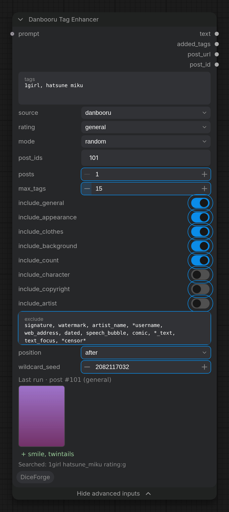

Adds tags to a prompt from random Danbooru or e621 posts that have its most telling tags: new posts on every run (random) or the same ones again (fixed); the last run's posts open in a window from the node.

Under its inputs, one row about the last run (*Last run: 2 posts, +7 tags*). Click it, or **🏷 Danbooru posts of the last run…** in the node's menu, for a window with the posts' pictures (click one to open the post; pictures that aren't general are blurred until clicked), the added tags (**Copy tags**), what it searched, and **Keep these posts (fixed)**. **📋 Copy the added tags** is in the menu too.

## Inputs

- `tags` (STRING, default `1girl, hatsune miku`): The tags to find posts with (or connect positive\_text of CLIP Dual Text Encode). Wildcards and {a|b} choices are filled in (\_\_characters\_\_: a new character each run); weights, escapes and &lt;lora:> tags are read through.
- `source` (COMBO, default `danbooru`): Where the posts come from: Danbooru (anime: Illustrious, NoobAI, Anima, Pony), e621 (furry: NoobAI, Pony) or Safebooru (safe anime pictures, Danbooru's tags). Each has its own tags: the tag list of the site (Tag autocomplete) helps the search.
- `rating` (COMBO, default `general`): The posts' ratings, from safe on: general, sensitive (suggestive), questionable (nudity), explicit; one, two next to each other, up to questionable, sensitive and up, or any. e621 has safe (general and sensitive), questionable and explicit.
- `mode` (COMBO, default `random`): random: new posts (and wildcards) on every run, written into post\_ids. fixed: the posts of post\_ids again, with the same wildcards: switch to it to keep a run you like.
- `post_ids` (STRING): The posts of the last random run (filled in by the node). In fixed mode, the posts used: ids or post links, separated by commas.
- `prompt` (STRING, optional): Optional: the rest of the prompt (quality tags, style: masterpiece, best quality...). It goes first in text, is never searched, and its tags are not added again.

## Advanced inputs

Under **Show advanced inputs** on the node (Nodes 2.0), or **Show Advanced** in its right-click menu (classic design).

- `posts` (INT, default `1`): Posts taken at once (random mode): their tags together, the ones more of them share first. Steadier than one post.
- `max_tags` (INT, default `15`): Tags added at most (the most used first); 0: all of the posts'.
- `include_general` (BOOLEAN, default on): Add the posts' general tags (what is in the picture: pose, clothes, background...).
- `include_appearance` (BOOLEAN, default on): Add appearance tags (hair color and style, eyes, skin, body, ears, tail...). Off: your character keeps its own look.
- `include_clothes` (BOOLEAN, default on): Add clothes and accessories (shirt, skirt, uniform, hair ornament, glasses, nude...). Off: your character keeps its own outfit.
- `include_background` (BOOLEAN, default on): Add the scene (simple background, outdoors, classroom, night, on bed...). Off: your prompt keeps its own place.
- `include_count` (BOOLEAN, default on): Add people-count tags (1girl, 2girls, 1boy, multiple\_boys, solo, no\_humans...). Off: the prompt keeps its own count.
- `include_character` (BOOLEAN, default off): Add the posts' characters.
- `include_copyright` (BOOLEAN, default off): Add the posts' series.
- `include_artist` (BOOLEAN, default off): Add the posts' artists (artist styles).
- `exclude` (STRING, default `signature, watermark, a…`): Tags never added, separated by commas; \* is any text (\*censor\* leaves out bar\_censor, censored, mosaic\_censoring).
- `position` (COMBO, default `after`): Where the added tags go: after the prompt's tags or before them.
- `wildcard_seed` (INT, default `0`): The seed of the wildcards in tags: a new one each random run (filled in by the node), this one in fixed mode.

## Outputs

- `text` (STRING): The prompt with the added tags: connect it to CLIP Dual Text Encode's positive (or a text encoder).
- `added_tags` (STRING): Only the added tags.
- `post_url` (STRING): The Danbooru posts the tags came from, one link per line.
- `post_id` (INT): The id of the first one.

More in the [DiceForge guide](https://github.com/DeduxOnline/ComfyUI-DiceForge#danbooru-tag-enhancer): examples, tips, and how it works with the other nodes.
