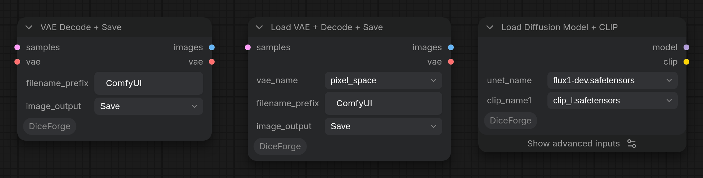

## Utility nodes

- **Load VAE + Decode + Save** (`DiceForge/image`, `DiceForge/load_vae_decode_save.py`): Load VAE, VAE Decode and Save Image in one node. It decodes the latent (`samples`) with the VAE picked in `vae_name` and saves PNG files with the workflow under `filename_prefix`, like Save Image, and passes the images on (`images`). The VAE stays loaded between runs while its name stays the same. The `vae` output passes the VAE on (for VAE Encode in a hires fix or inpaint).
- **VAE Decode + Save** (`DiceForge/image`): the same without Load VAE, with the VAE from its `vae` input (the VAE of Load Checkpoint, Load VAE, Random VAE…).
- `image_output` decides what both do with the images, as in Easy-Use's samplers: *Hide* (only passed on), *Preview* (shown, not saved), *Save* (saved and shown, the default) or *Hide&Save* (saved, not shown).
- **Load Diffusion Model + CLIP** (`DiceForge/loaders`, `DiceForge/load_diffusion_model_clip.py`): Load Diffusion Model and Load CLIP in one node, for models that come as separate files (Flux, Anima, Qwen-Image...): the model (`unet_name`) from `models/diffusion_models` and one text encoder (`clip_name1`), or two like DualCLIPLoader when `clip_name2` is set. The CLIP `type` is checked against the number of files before anything loads. Under the advanced inputs: `clip_name2` (a second text encoder; `None` loads only `clip_name1`), `type` (the model the text encoders are for, `stable_diffusion` by default: set it for Flux, Anima, Qwen-Image...), `weight_dtype` (the model's precision) and `device` (where the text encoders run). Outputs: `model` and `clip`, as the two core loaders give them.
