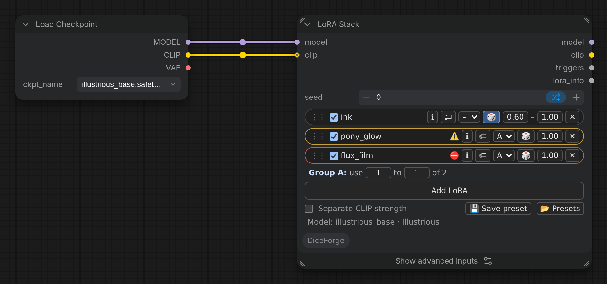

Applies several LoRAs, each with its own on/off and strength, like rgthree's Power Lora Loader. A strength can be a random range, and groups of LoRAs can take turns (use 1 of these 5), picked with the DiceForge seed modes. Also outputs the trigger words and what was applied.

The LoRAs are rows on the node: **⋮⋮** (drag to reorder), on/off, the LoRA (click its name to pick another one), **ℹ** (Model info), **🏷** (trigger words), a **group**, **🎲** (random strength), the strength and **✕** (remove). **＋ Add LoRA** opens the LoRA Browser; *Separate CLIP strength* and the groups' settings are under the rows.

## Inputs

- `model` (MODEL): The diffusion model the LoRAs are applied to.
- `clip` (CLIP, optional): The CLIP model the LoRAs are applied to. Leave it unconnected to change only the model.
- `seed` (INT, default `0`): Seed for random strengths and groups. With deck or sequential, set control after generate to increment.

## Advanced inputs

Under **Show advanced inputs** on the node (Nodes 2.0), or **Show Advanced** in its right-click menu (classic design).

- `seed_mode` (COMBO, default `random`): How the pick changes from run to run. random: every pick is independent, so the same one can come up again soon. deck: the seed steps through a shuffled order of the strengths and group combinations; with control after generate on increment, every one comes once before any repeats. Reproducible. shuffle: like shuffle in a music player, the node remembers the strengths and group combinations already used and picks from the rest with each new seed (increment or randomize); remembered in a file, so it continues after a restart. The same seed gives the same pick again. balanced: one just picked gets a low chance, and those not picked for a while get a higher one, so repeats are rare but possible. Remembered in a file. The same seed gives the same pick again. sequential: the seed is the position in the list (sorted by name), so seeds 0, 1, 2... go through the strengths and group combinations in order. Reproducible.

## Outputs

- `model` (MODEL): The model with the LoRAs applied.
- `clip` (CLIP): The CLIP with the LoRAs applied (unconnected CLIP input: nothing).
- `triggers` (STRING): The trigger words of the applied LoRAs (yours from Model info, else Civitai's), for CLIP Dual Text Encode.
- `lora_info` (STRING): The applied LoRAs and strengths, for example 'detail 0.8, style\_a 1.0', for a file name or a note.

More in the [DiceForge guide](https://github.com/DeduxOnline/ComfyUI-DiceForge#lora-stack): examples, tips, and how it works with the other nodes.
