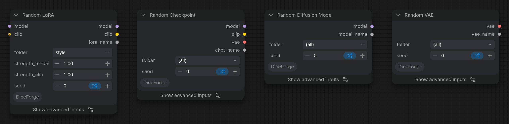

Loads a checkpoint picked from a folder, like Load Checkpoint, with the DiceForge seed modes (deck, shuffle... go through every checkpoint before repeating one).

## Inputs

- `folder` (COMBO, default `(all)`): The folder to pick the checkpoint from, subfolders included. (all): every checkpoint. Refresh the node definitions (R) after adding folders.
- `seed` (INT, default `0`): Seed for the random pick. With deck or sequential, set control after generate to increment.

## Advanced inputs

Under **Show advanced inputs** on the node (Nodes 2.0), or **Show Advanced** in its right-click menu (classic design).

- `seed_mode` (COMBO, default `random`): How the pick changes from run to run. random: every pick is independent, so the same one can come up again soon. deck: the seed steps through a shuffled order of the checkpoints; with control after generate on increment, every one comes once before any repeats. Reproducible. shuffle: like shuffle in a music player, the node remembers the checkpoints already used and picks from the rest with each new seed (increment or randomize); remembered in a file, so it continues after a restart. The same seed gives the same pick again. balanced: one just picked gets a low chance, and those not picked for a while get a higher one, so repeats are rare but possible. Remembered in a file. The same seed gives the same pick again. sequential: the seed is the position in the list (sorted by name), so seeds 0, 1, 2... go through the checkpoints in order. Reproducible.

## Outputs

- `model` (MODEL): The model used for denoising latents.
- `clip` (CLIP): The CLIP model used for encoding text prompts.
- `vae` (VAE): The VAE used for encoding and decoding images to and from latent space.
- `ckpt_name` (STRING): The picked checkpoint file, for example for the file name of the image.

More in the [DiceForge guide](https://github.com/DeduxOnline/ComfyUI-DiceForge#random-lora-random-checkpoint-random-diffusion-model-and-random-vae): examples, tips, and how it works with the other nodes.
