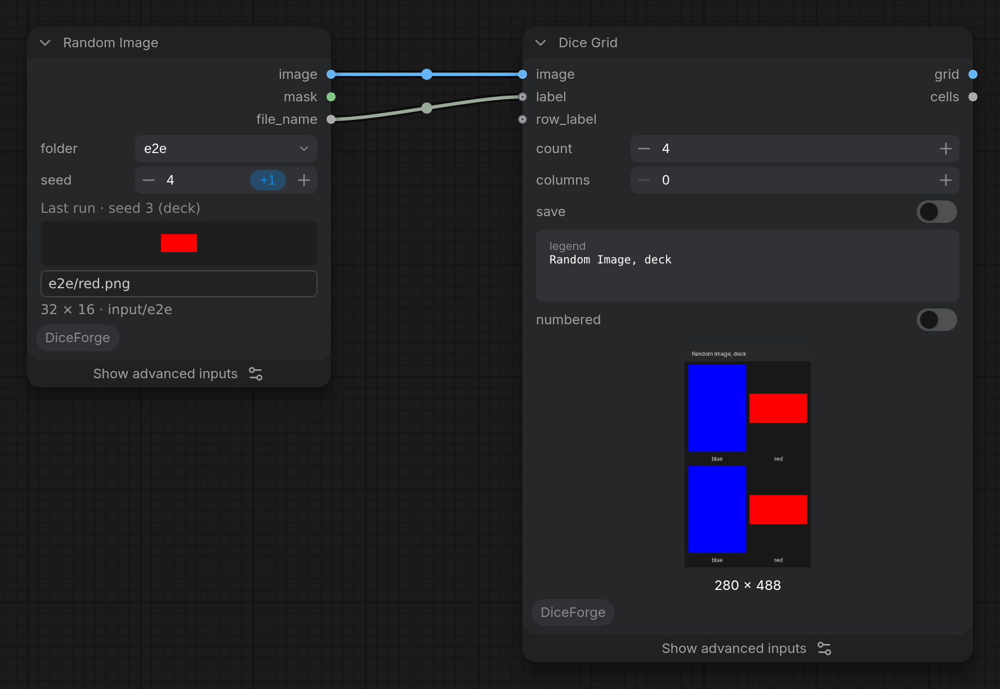

Loads an image picked from a folder, like Load Image, with the DiceForge seed modes (deck, shuffle... go through every image before repeating one).

## Inputs

| Input | Type | Default | Description |
|---|---|---|---|
| `folder` | COMBO | `(all)` | The folder in ComfyUI/input to pick the image from, subfolders included. (all): every image in input. Refresh the node definitions (R) after adding folders. |
| `seed` | INT | `0` | Seed for the random pick. With deck or sequential, set control after generate to increment. |

## Advanced inputs

Under **Show advanced inputs** on the node (Nodes 2.0), or **Show Advanced** in its right-click menu (classic design).

| Input | Type | Default | Description |
|---|---|---|---|
| `seed_mode` | COMBO | `random` | How the pick changes from run to run. random: every pick is independent, so the same one can come up again soon. deck: the seed steps through a shuffled order of the images; with control after generate on increment, every one comes once before any repeats. Reproducible. shuffle: like shuffle in a music player, the node remembers the images already used and picks from the rest with each new seed (increment or randomize); remembered in a file, so it continues after a restart. The same seed gives the same pick again. balanced: one just picked gets a low chance, and those not picked for a while get a higher one, so repeats are rare but possible. Remembered in a file. The same seed gives the same pick again. sequential: the seed is the position in the list (sorted by name), so seeds 0, 1, 2... go through the images in order. Reproducible. |
| `path` | STRING |  | Any folder on this computer to pick from instead of the input folder, for example D:/refs/poses (subfolders included). Empty: use folder. |

## Outputs

| Output | Type | Description |
|---|---|---|
| `image` | IMAGE | The picked image (all frames of an animated image). |
| `mask` | MASK | The mask from the image's alpha channel (1 where transparent), as in Load Image. |
| `file_name` | STRING | The picked file, relative to the folder, for example for the file name of the result. |

More in the [DiceForge guide](https://github.com/DeduxOnline/ComfyUI-DiceForge#random-image): examples, tips, and how it works with the other nodes.
