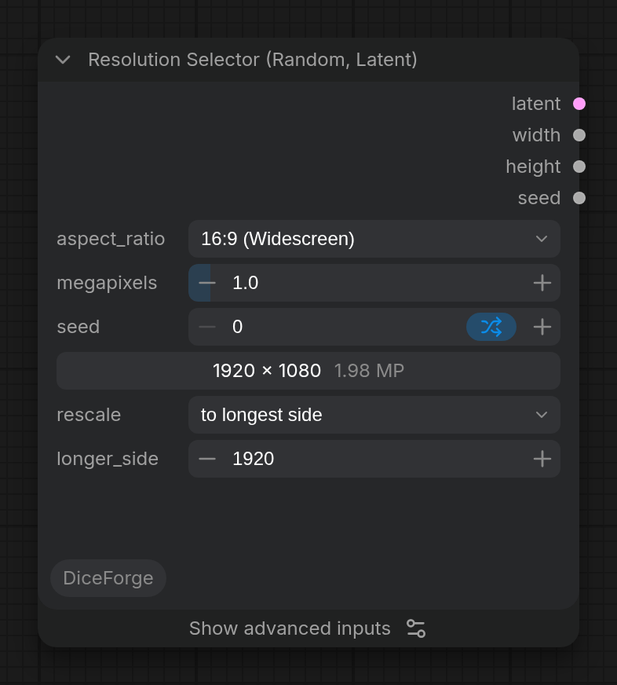

Calculate a size from an aspect ratio and a megapixel target (or a random aspect ratio from the seed) and output an empty latent of that size.

## Inputs

- `aspect_ratio` (COMBO, default `1:1 (Square)`): Aspect ratio for the output dimensions. Random options pick one from the seed: listed ratios, or any ratio up to max\_aspect for Chaos.
- `megapixels` (FLOAT, default `1`): Target total megapixels. 1.0 MP = 1024x1024 for square.
- `preview` (RESOLUTION_PREVIEW): Live preview of the calculated output resolution. Random options show the size of the last run, until the settings change.
- `seed` (INT, default `0`): Seed for random aspect ratio selection. Ignored for fixed aspect ratios.
## Advanced inputs

Under **Show advanced inputs** on the node (Nodes 2.0), or **Show Advanced** in its right-click menu (classic design).

- `multiple` (INT, default `8`): Round width and height to a multiple of this value (8 for the VAE, 64 for SDXL training buckets). Random Chaos sizes round down.
- `batch` (INT, default `1`): Number of images to generate in a batch.
- `max_aspect` (FLOAT, default `2`): Random Chaos options only: the most stretched aspect ratio allowed (2.0 = up to 2:1 or 1:2).
- `seed_mode` (COMBO, default `random`): How random sizes change from run to run. random: every pick is independent, so the same size can come up again soon. deck: the seed steps through a shuffled order; with control after generate on increment, every size comes once before any repeats. Reproducible. shuffle: like shuffle in a music player, the node remembers the sizes already used and picks from the rest with each new seed (increment or randomize); remembered in a file, so it continues after a restart. The same seed gives the same size again. balanced: a size just picked gets a low chance, and sizes not picked for a while get a higher one, so repeats are rare but possible. Remembered in a file. The same seed gives the same size again. sequential: the seed is the position in the list, so seeds 0, 1, 2... go through the sizes in order. Reproducible. Random Chaos: the aspect range is split into equal parts that take turns (in order for sequential), with a random ratio inside each part.

## Outputs

- `latent` (LATENT): Empty latent batch, the same as Empty Latent Image makes for this size.
- `width` (INT): Width of the latent in pixels.
- `height` (INT): Height of the latent in pixels.
- `seed` (INT): The seed used for this run, for example to pass on to KSampler.

More in the [DiceForge guide](https://github.com/DeduxOnline/ComfyUI-DiceForge#resolution-selector-random): examples, tips, and how it works with the other nodes.
