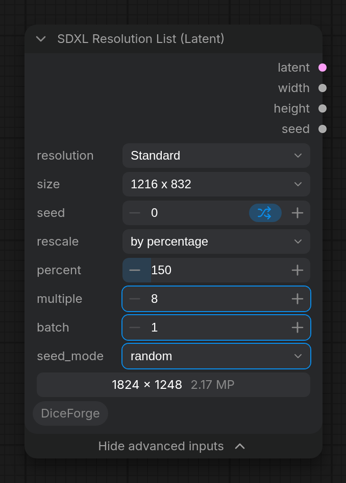

### SDXL Resolution List

Node id: `DiceForgeSDXLResolutionList`.

The resolution is a nested list: first pick a group in `resolution`, then a size of that group in `size`. The Random Chaos group also shows `max_aspect`.

#### Inputs

| Input | Section | Default | Description |
|---|---|---|---|
| `resolution` | main | `Standard` | Group: `Standard`, `High-Res`, `Random` or `Random Chaos` (see below). |
| `size` | main | `1024 x 1024` | A size of the chosen group: a fixed size for Standard and High-Res, a list to pick from for Random, an orientation for Random Chaos (`Any`, `Portrait` or `Landscape`). |
| `max_aspect` | main (Random Chaos only) | `2.0` | The most stretched aspect ratio Random Chaos may pick (1.0–4.0): 2.0 means up to 2:1 or 1:2, 1.0 gives only squares. |
| `preview` | main | — | Live preview of the output size and megapixels, the same widget as in the core *Resolution Selector*. Drawn in the Nodes 2.0 design only: in the classic canvas this core widget stays empty, in the core *Resolution Selector* too. For the Random and Random Chaos groups it shows the size of the last run, as long as the settings other than `seed` stay the same, and "—" before a run or after a change. |
| `seed` | main | `0` | Seed for the random options. The same seed always gives the same size. |
| `rescale` | main | `by percentage` | Rescales the picked size, like the HiresFix node of Easy-Use. The input under it depends on the mode (below). Then the size is rounded to `multiple`, taking the nearby multiples closest to the exact aspect ratio. |
| `percent` | main (*by percentage*) | `100` | Each side in percent (5–1000): `150` turns 1024x1024 into 1536x1536, `50` into 512x512. The number of pixels (megapixels) grows by its square: `150` gives 2.25 times the pixels, `200` four times. |
| `width`, `height` | main (*to Width/Height*) | `1536`, `0` | A width and/or a height. With one of them `0`, the other side follows the aspect ratio (width 1536: 1216x832 becomes 1536x1048); with both set, exactly that size, whatever size was picked; with both `0`, the size stays as picked. |
| `longer_side` | main (*to longest side*) | `1536` | The longest side, keeping the aspect ratio: 1216x832 becomes 1536x1048 and 832x1216 becomes 1048x1536. Good for random sizes: every size ends up with the same longest side. |
| `multiple` | Advanced | `8` | Rounds width and height to the nearest multiple of this value (8–256, in steps of 8). Use 64 for SDXL training sizes. |
| `batch` | Advanced | `1` | Number of latents in the batch (1–32). |
| `seed_mode` | Advanced | `random` | How the random groups change from run to run: `random`, `deck`, `shuffle`, `balanced` or `sequential`. See [Seed modes for sizes](https://github.com/DeduxOnline/ComfyUI-DiceForge#seed-modes-for-sizes). |

#### Outputs

| Output | Description |
|---|---|
| `latent` | Empty latent batch, identical to what **Empty Latent Image** makes for this size and `batch`. Connect it to the `latent_image` input of **KSampler**. |
| `width` | Width in pixels, for example for an upscale or hires-fix step. |
| `height` | Height in pixels. |
| `seed` | The seed used for this run, the same as the node's `seed` input. For example, connect it to the `seed` input of **KSampler**. |

#### Fixed sizes

The `size` list shows width x height; the aspect ratios are given here for reference.

| Standard | High-Res |
|---|---|
| 1024 x 1024 (1:1) | 1536 x 1536 (1:1) |
| 1152 x 896 (9:7) / 896 x 1152 (7:9) | 1536 x 1152 (4:3) / 1152 x 1536 (3:4) |
| 1216 x 832 (3:2) / 832 x 1216 (2:3) | 1536 x 1024 (3:2) / 1024 x 1536 (2:3) |
| 1344 x 768 (16:9) / 768 x 1344 (9:16) | 1536 x 864 (16:9) / 864 x 1536 (9:16) |
| 1536 x 640 (21:9) / 640 x 1536 (9:21) | |

#### Random groups

- **Random**: picks one of the listed sizes at random from the seed.
  - **Any Listed / Any High-Res Listed**: one of the Standard or High-Res sizes above.
  - **Vertical Listed / Horizontal Listed** (and their **High-Res** versions): only portrait or only landscape sizes.
- **Random Chaos**: a random aspect ratio up to `max_aspect`, at about 1024x1024 pixels (the SDXL native size), then rescaled like the other groups: by percentage 150 gives about 1536x1536 pixels (2.25 MP), to longest side 1536 gives a longest side of exactly 1536.
  - **Any**: wide or tall, equally likely (the ratio is picked evenly in log scale).
  - **Portrait / Landscape**: only taller than wide, or only wider than tall; never a square. When the size would round to a square, the shorter side steps down one `multiple`; if `rescale` sets that side (or it is already the smallest), the longer side steps up instead. What `rescale` sets is kept: an exact size (`to Width/Height` with both sides) or a longest side at the smallest `multiple` can be a square.
  - The size rounds down to `multiple`, so it never exceeds its rescaled budget (it lands at about 0.9–1.0 of that).

#### Notes

- Rounding to `multiple` applies to fixed sizes too. With the default 8 every listed size stays exact; with 64, 864 becomes 896.
- Like any `seed` input, it gets the frontend's *control after generate* option, which is *randomize* by default, so the random options give a new size on each run. Set it to *fixed* to keep the same size.
