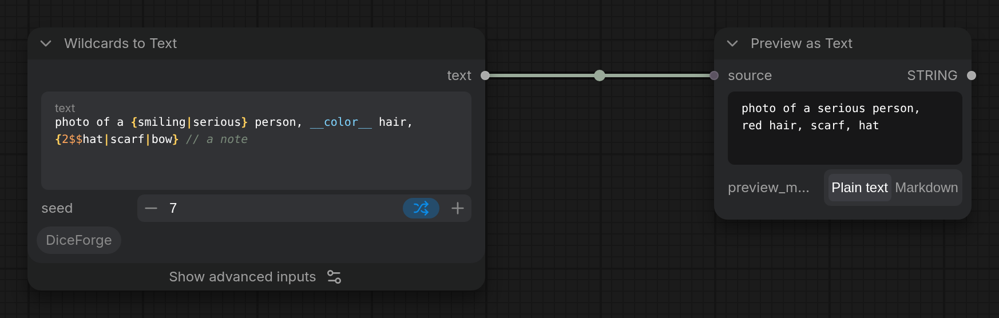

Fills in a prompt's {a|b} choices, \_\_name\_\_ wildcards and ${name} variables from the seed, as CLIP Dual Text Encode does, and outputs the text, for any text encoder or text input.

## Inputs

- `text` (STRING): The prompt: {a|b} choices, \_\_name\_\_ wildcards, ${name=value} / ${name} variables (the same syntax as CLIP Dual Text Encode).
- `seed` (INT, default `0`): Seed for the choices and wildcards. The same seed always gives the same text, in every mode.

## Advanced inputs

Under **Show advanced inputs** on the node (Nodes 2.0), or **Show Advanced** in its right-click menu (classic design).

- `seed_mode` (COMBO, default `random`): How choices and wildcards change from run to run. random: every pick is independent, so the same option can come up again soon. deck: the seed steps through a shuffled order of the options; with control after generate on increment, every option comes once before any repeats. Reproducible. shuffle: like shuffle in a music player, the node remembers the options already used and picks from the rest with each new seed (increment or randomize); remembered in a file, so it continues after a restart. The same seed gives the same result again. balanced: an option just picked gets a low chance, and options not picked for a while get a higher one, so repeats are rare but possible. Remembered in a file, so it continues after a restart. The same seed gives the same result again. combinations: the seed numbers every combination of the options, so seeds 0, 1, 2... go through all of them once (the console shows how many). Reproducible. mutate: keeps the last prompt and changes just one choice each run with a new seed, to explore variations of a good result. Remembered in a file, so it continues after a restart. The same seed gives the same result again.
- `trim` (BOOLEAN, default on): Remove extra spaces: at the start and end of lines, double spaces, spaces before , . ; : ! ? ) and after (, and extra empty lines.

## Outputs

- `text` (STRING): The prompt with its choices, wildcards and variables filled in.

More in the [DiceForge guide](https://github.com/DeduxOnline/ComfyUI-DiceForge#wildcards-to-text): examples, tips, and how it works with the other nodes.
