# DiceForge

[](https://github.com/DeduxOnline/ComfyUI-DiceForge/actions/workflows/tests.yml)
[](https://sonarcloud.io/summary/new_code?id=DeduxOnline_ComfyUI-DiceForge)
[](https://sonarcloud.io/summary/new_code?id=DeduxOnline_ComfyUI-DiceForge)
[](https://sonarcloud.io/summary/new_code?id=DeduxOnline_ComfyUI-DiceForge)
[](https://sonarcloud.io/summary/new_code?id=DeduxOnline_ComfyUI-DiceForge)
[](https://sonarcloud.io/summary/new_code?id=DeduxOnline_ComfyUI-DiceForge)

**Controlled randomness for ComfyUI.** Every random pick in these nodes (a prompt choice, a wildcard line, an image size, a number, a LoRA) follows a *seed mode* you choose. Plain random repeats itself: roll 5 skies 5 times and you get about 3 different ones. DiceForge can deal them like cards, shuffle them like a playlist, balance the odds like a game, go through every combination, or change one detail at a time.

| Seed mode | What it does |
|---|---|
| `random` | Every pick is independent, as usual. |
| `deck` | The seed deals from a shuffled deck: with *increment*, every option comes once per round. |
| `shuffle` | Like shuffle in a music player: remembers what came up and picks from the rest with each new seed. |
| `balanced` | Like pseudo-random odds in games: repeats are rare but possible, nothing waits too long. |
| `sequential` | The seed is the position in the list: seeds 0, 1, 2… in order (sizes, numbers, files). |
| `combinations` | Seeds 0, 1, 2… go through every combination of the whole prompt (prompts). |
| `mutate` | Keeps the last prompt and changes one choice per run (prompts). |

Every mode gives the same result for the same seed, so an image can be made again from its seed. The remembering modes (`shuffle`, `balanced`, `mutate`) keep their memory in a small file, so they continue after a restart; a new seed (*increment* or *randomize*) moves them on, and a seed that came before gives its result again. Details: [seed modes for prompts](#seed-modes), [seed modes for sizes and numbers](#seed-modes-for-sizes), [memory file](#memory-file).

Around the nodes, DiceForge adds tools to ComfyUI's right-click menus: [model browsers](#model-browsers) with Civitai previews and downloads, [Model info](#model-info), [KSampler presets](#ksampler-presets), [prompt styles](#prompt-styles), and a [Danbooru tag autocomplete](#tag-autocomplete-danbooru-e621) and [Tag Browser](#tag-browser).

## Contents

- [Installation](#installation) · [Nodes](#nodes) · [Quick start](#quick-start)
- [Prompts](#prompts): [CLIP Dual Text Encode](#clip-dual-text-encode), [wildcards](#wildcard-files), [tag autocomplete](#tag-autocomplete-danbooru-e621), [Tag Browser](#tag-browser), [prompt styles](#prompt-styles), [Danbooru Tag Enhancer](#danbooru-tag-enhancer)
- [Image sizes](#image-sizes): [SDXL Resolution List](#sdxl-resolution-list-latent), [Resolution Selector](#resolution-selector-random-latent), [seed modes for sizes](#seed-modes-for-sizes)
- [Random nodes](#random-nodes): [Random Int and Float](#random-int-and-random-float), [random loaders](#random-lora-random-checkpoint-random-diffusion-model-and-random-vae), [Random Image](#random-image), [Random Sampler](#random-sampler)
- [Sampling and upscaling](#sampling-and-upscaling): [KSampler presets](#ksampler-presets), [Variation Seed](#variation-seed), [Hires Fix](#hires-fix), [HiresFix (Load VAE)](#hiresfix-load-vae)
- [Comparing results](#comparing-results): [XY Plot](#xy-plot), [Dice Grid](#dice-grid)
- [LoRAs and models](#loras-and-models): [LoRA Stack](#lora-stack), [Model info](#model-info), [model browsers](#model-browsers)
- [Utility nodes](#utility-nodes) · [Development](#development) ([tests](#tests), [releasing](#releasing))

## Installation

**ComfyUI Manager:** open *Manager → Custom Nodes Manager*, search for **DiceForge**, click *Install* and restart ComfyUI.

**comfy-cli:**

```sh
comfy node install comfyui-diceforge
```

**git:** clone the repository into `custom_nodes` and restart ComfyUI:

```sh
cd ComfyUI/custom_nodes
git clone https://github.com/DeduxOnline/ComfyUI-DiceForge.git
```

The nodes and the frontend are in the `DiceForge` subfolder; the repository's own `__init__.py` loads them, so the whole repository goes into `custom_nodes`. If you installed an earlier version by copying only the `DiceForge` folder into `custom_nodes`, delete that copy: two copies would register the same nodes twice. Your wildcards, presets, styles, favorites, tag lists and seed memory are in `ComfyUI/user/DiceForge` and `ComfyUI/models/wildcards`, so they stay.

Every version is listed in [CHANGELOG.md](CHANGELOG.md) and released on [GitHub](https://github.com/DeduxOnline/ComfyUI-DiceForge/releases) and the [ComfyUI Registry](https://registry.comfy.org); ComfyUI Manager shows when an update is out.

**Requirements:** a recent ComfyUI that includes `comfy_api.latest` (the V3 node API). *Resolution Selector (Random, Latent)* also needs the resolution preview widget, which ships with the core *Resolution Selector* node. Older ComfyUI versions will not load these nodes.

### Updating from ResolutionForge

DiceForge was called *ResolutionForge* while it was a resolution pack. To update, delete `ComfyUI/custom_nodes/ResolutionForge` and install the `DiceForge` folder (having both loads the nodes twice).

- Saved workflows keep working: the nodes keep their ids, only their menu moved to **DiceForge**.
- *Random Int* and *Random Float* got new ids (`DiceForgeRandomInt`, `DiceForgeRandomFloat`): add them again in workflows saved with the first version.
- The memory file moves by itself from `ComfyUI/user/ResolutionForge` to `ComfyUI/user/DiceForge` on the first run.
- Earlier versions also had *SDXL Resolution List* and *Resolution Selector (Random)*, which output `width`, `height` and `batch` for **Empty Latent Image**. They were removed: use the *Latent* nodes, which take the same inputs.

## Nodes

| Node | Menu | Use it when |
|---|---|---|
| **Prompts** | | |
| [**CLIP Dual Text Encode**](#clip-dual-text-encode) | DiceForge/conditioning | You want positive and negative prompts in one node, with wildcards, `{a\|b}` choices, variables, locked choices and `<lora:>` tags that follow the seed modes. It also outputs the filled-in text, and works without a CLIP as a text-only prompt builder for other encoders. |
| [**Danbooru Tag Enhancer**](#danbooru-tag-enhancer) | DiceForge/conditioning | You want a richer prompt from a few tags: it adds the tags of a random Danbooru post that has your tags, the way anime models were trained. |
| **Image sizes** | | |
| [**SDXL Resolution List (Latent)**](#sdxl-resolution-list-latent) | DiceForge/latent | You want the standard SDXL sizes (1024x1024, 1216x832, ...) from a fixed list, or picked at random, rescaled like Easy-Use's HiresFix. |
| [**Resolution Selector (Random, Latent)**](#resolution-selector-random-latent) | DiceForge/latent | You want to set an aspect ratio and a megapixel target, like the core *Resolution Selector* node, or pick the ratio at random. |
| **Random** | | |
| [**Random Int, Random Float**](#random-int-and-random-float) | DiceForge/random | You want a random number (steps, CFG, denoise, LoRA strength) that goes through the whole range instead of clustering. |
| [**Random Sampler**](#random-sampler) | DiceForge/sampling | You want to compare samplers and schedulers: it picks a pair for KSampler from the ones you list. |
| [**Random LoRA, Random Checkpoint, Random Diffusion Model, Random VAE**](#random-lora-random-checkpoint-random-diffusion-model-and-random-vae) | DiceForge/loaders | You want to try the files of a folder one after another, like the core loader with the file picked for you. |
| [**Random Image**](#random-image) | DiceForge/loaders | You want an input image (img2img, ControlNet pose, IP-Adapter reference) picked from a folder, like **Load Image** with the file picked for you. |
| **LoRAs and models** | | |
| [**LoRA Stack**](#lora-stack) | DiceForge/loaders | You want several LoRAs in one node, like rgthree's *Power Lora Loader*, with random strengths, LoRAs that take turns, base model checks and their trigger words as text. |
| [**Load Diffusion Model + CLIP**](#utility-nodes) | utils | You want Load Diffusion Model and Load CLIP in one node, for models that come as separate files (Flux, Anima, Qwen-Image...). |
| **Sampling and upscaling** | | |
| [**Variation Seed**](#variation-seed) | DiceForge/sampling | You like a picture and want it again with small differences (folds, hair, background, a hand), as A1111's variation seed. |
| [**Hires Fix**](#hires-fix) | DiceForge/sampling | You want a bigger image with new detail in one node: the first pass's latent made bigger (in the latent, or in pixels with an upscale model) and sampled again at low denoise. |
| [**HiresFix (Load VAE)**](#hiresfix-load-vae) | DiceForge/image | You want Easy-Use's HiresFix with the VAE picked from a list: upscale model, rescale, preview or save, and a latent for your own second KSampler pass. |
| **Comparing results** | | |
| [**XY Plot**](#xy-plot) | DiceForge/sampling | You want an X/Y comparison in one node: seed, steps, CFG, sampler, scheduler, LoRA, LoRA strength, denoise or variation seed/strength on each axis, every combination queued with one button. |
| [**Dice Grid**](#dice-grid) | DiceForge/image | You want the images of a series side by side with labels (a LoRA, checkpoint or setting comparison, or an XY grid), and to keep the best ones at full size. |
| **Decoding and saving** | | |
| [**Load VAE + Decode + Save, VAE Decode + Save**](#utility-nodes) | utils | You want VAE Decode and Save Image (and Load VAE) in one node, with Easy-Use's *image_output* choice. |

All nodes use the ComfyUI V3 node schema: in the Nodes 2.0 frontend, the secondary inputs (including `seed_mode`) sit in the node's **Advanced** section. Every node works in both node designs, Nodes 2.0 and classic.

The anime prompt builder *Prompt Director* lives in its own repository: [DeduxOnline/ComfyUI-PromptDirector](https://github.com/DeduxOnline/ComfyUI-PromptDirector).

## Quick start

- Connect the `latent` output of a resolution node to the `latent_image` input of **KSampler**.
- Connect the `CLIP` output of your checkpoint loader to **CLIP Dual Text Encode**, then its `positive` and `negative` outputs to the matching inputs of **KSampler**.
- To drive the image and the canvas size from one seed, connect the `seed` output of a resolution node to the `seed` input of **KSampler**.
- To compare LoRAs or checkpoints, use **Random LoRA** or **Random Checkpoint** with `seed_mode` `deck` and *increment*: every file of the folder comes once before any repeats.
- For img2img or ControlNet over a folder of images, use **Random Image** the same way.
- To compare samplers, connect **Random Sampler** to KSampler's `sampler_name` and `scheduler`, and its `label` to **Dice Grid**.
- To see a series side by side, connect the image and the loader's file name output to **Dice Grid**: it saves a labeled grid after each round.
- To try a range of values, convert a KSampler input such as `cfg` to an input and connect **Random Float** (`min` 4, `max` 8, `step` 0.5) to it.
- For a series of images without repeats, set `seed_mode` to `deck` and *control after generate* to *increment* on each DiceForge node (reproducible), or use `shuffle` with *increment* or *randomize* (it continues after a restart). Both give an image's result again from its seed.
- To get a prompt from a few tags, put **Danbooru Tag Enhancer** before CLIP Dual Text Encode, or type tags with the [tag autocomplete](#tag-autocomplete-danbooru-e621).
- For the right sampler settings, right-click KSampler → **🎲 Sampler presets** → **✨ Auto**.

## Prompts

### CLIP Dual Text Encode

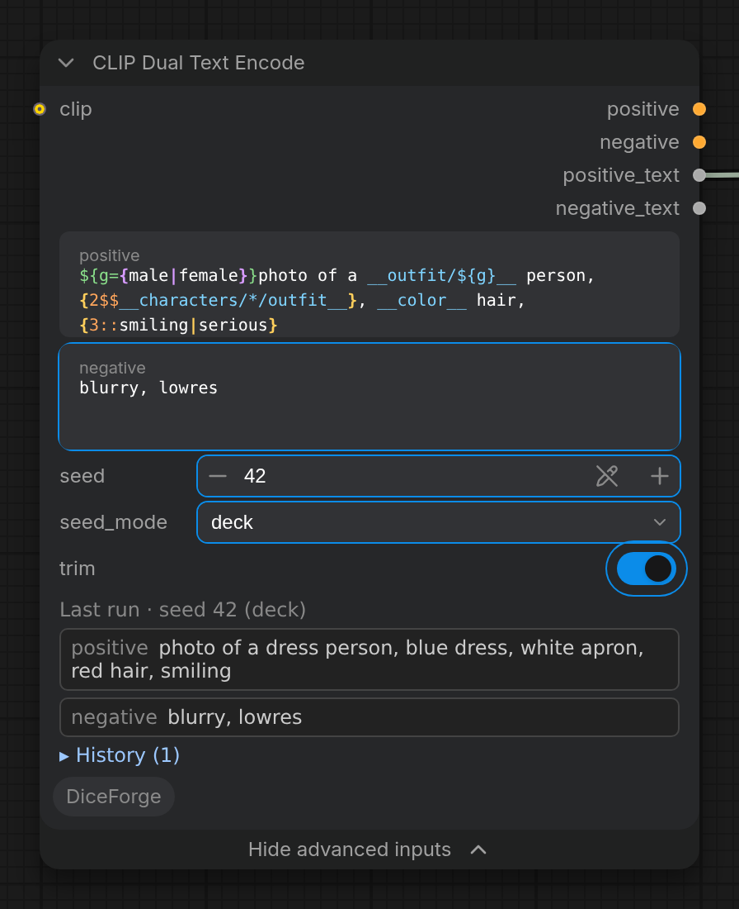

Node id: `CLIPTextEncodePositiveNegative`.

Works like two core *CLIP Text Encode (Prompt)* nodes sharing one CLIP model: each prompt is encoded exactly the same way, so the conditioning is identical to the core node's for the same text. On top of that, both prompts support wildcards and `{a|b}` choices, picked from a seed.

Its right-click menu has the prompt tools: **🎲 Wildcard Browser**, **🎴 LoRA Browser** (to insert trigger words), **🏷 Tag autocomplete** (download tag lists), **🏷 Tag Browser** and **🎨 Prompt styles**.

#### Inputs

| Input | Section | Description |
|---|---|---|
| `clip` | main | The CLIP model used for encoding both prompts. Optional: without it the node only fills in the prompts, for the text outputs. |
| `model` | main | Optional: the model, for [`<lora:...>` in the prompts](#loras-in-the-prompt). Passed through to the `model` output when the prompts have none. |
| `positive` | main | The positive prompt (top text field): what the image should contain. |
| `negative` | Advanced | The negative prompt: what the image should avoid. Under *Show advanced inputs*, since it is usually set once; it is used and saved the same when hidden. |
| `seed` | Advanced | Seed for choices and wildcards. The same seed always gives the same prompts, in every mode. By default it is randomized after each run (*control after generate*); set it to *fixed* to repeat a result. |
| `seed_mode` | Advanced | How choices and wildcards change from run to run: `random` (default), `deck`, `shuffle`, `balanced`, `combinations` or `mutate`. See [Seed modes](#seed-modes). |
| `trim` | Advanced | On by default: removes extra spaces from both prompts, at the start and end of lines, double spaces, spaces before `, . ; : ! ? )` and after `(`, and extra empty lines (`  a  girl , ( smile :1.1 )` becomes `a girl, (smile:1.1)`). Only spaces change. |

#### Outputs

| Output | Description |
|---|---|
| `positive` | Conditioning from the positive prompt. |
| `negative` | Conditioning from the negative prompt. |
| `positive_text` | The positive prompt as encoded, with choices, wildcards and variables filled in. |
| `negative_text` | The negative prompt as encoded, with choices, wildcards and variables filled in. |
| `model` | The model with the prompts' `<lora:...>` LoRAs. Connect it to KSampler instead of the loader's model. |

The text outputs carry the prompt that was actually used, for example to show it with a preview node, put it in a file name, or feed a text encoder for other models (Flux, SD3, video models): leave `clip` unconnected and the node only fills in the prompts, with every seed mode.

When choices or wildcards change a prompt, the filled-in prompts and the seed are printed to the ComfyUI console.

#### Prompt syntax

| Syntax | Result |
|---|---|
| `__name__` | A random line from the wildcard file `name.txt`. |
| `__folder/name__` | A random line from `folder/name.txt` inside a wildcards folder. |
| `__hair/*__` | A random line from all the files in the `hair` folder and its subfolders, as if they were one file. `*` matches any text (including `/`), `?` one character: `__*/color__` uses every `color.txt` in a subfolder, `__style_*__` every file starting with `style_`. |
| `{red\|green\|blue}` | One of the options at random. Options can be empty (`{big\|}`) and can nest (`{a\|{b\|c}}`). |
| `{3::cat\|dog}` | Weighted choice: `cat` is 3 times as likely as `dog`. Options without a weight count as 1. |
| `{2$$a\|b\|c}` | Two different options, joined with `, `. |
| `{1-3$$a\|b\|c}` | From 1 to 3 different options. `-2$$` means 0 to 2, and `2-$$` means 2 up to all of them. |
| `{2$$ and $$a\|b\|c}` | Two options joined with ` and ` instead of `, `. The separator has no braces, so a multi-pick can also be the first option: `{2$${2$$a\|b}\|c\|d}`. |
| `{2$$__color__}` | Two different lines of `color.txt` (sd-dynamic-prompts style): a multi-pick whose only option is a wildcard picks from its lines. All the forms above work: `{1-3$$ and $$__accessory__}`, `{2$$__hair/*__}`. |
| `${hair=__color__}` | Sets the variable `hair`: its value is filled in once (choices and wildcards included) and outputs nothing. `${hair=!...}` (sd-dynamic-prompts style) works the same. |
| `${hair}` | The value of `hair`, anywhere in the positive or negative prompt: `${hair=__color__}${hair} hair, ${hair} ribbon` gives `red hair, red ribbon`. |
| `__outfit/${g}__` | A variable in a wildcard name: `${g={male\|female}}1person, __outfit/${g}__` reads `outfit/male.txt` or `outfit/female.txt`, whichever `g` got, so related parts of a prompt match. The variable can be set anywhere in the same prompt, or in the positive prompt for the negative. Not available in the `combinations` seed mode (it cannot know in advance which file will be read). |
| `{sky\|!sea\|forest}` | Locked choice: always `sea`, in every seed mode, without rewriting the prompt. Remove the `!` to unlock. With several `!` options all of them are used. In `random` and `deck` the other choices keep their picks for the same seed; in `combinations` a locked choice counts once; in `mutate` it is never the one that changes. `3::!sea` works like `!3::sea`. |
| `// ...`, `/* ... */` | Comments, removed before encoding. |

To write `{`, `}` or `|` literally, put a backslash before it: `\{`, `\}`, `\|`. An option that should start with a real `!` is written `\!`.

Weights and counts can be combined, for example `{2$$3::hat|scarf|bow}`. Plain `{a|b}` choices give the same result for the same seed as before these options were added.

Commas left behind by empty options are cleaned up: `a girl, {|cat}, smile` becomes `a girl, smile` rather than `a girl, , smile`. Doubled commas, spaces before commas and commas at the start or end of the prompt are removed too.

Variables are shared by both prompts and can be set in a wildcard file line too (for example a character file that sets `${hair=...}`). A variable can be used before or after it is set; if it is set twice, the last value is used everywhere. Using a variable that is never set stops the run with an error that names it.

Prompt weights such as `(word:1.2)` and embeddings work as in the core node.

Lines picked from a wildcard file can themselves contain wildcards and `{a|b}` choices; they are filled in too, up to 50 levels deep (a wildcard that includes itself stops with an error instead of looping forever).

#### Seed modes

In `random` mode every pick is independent, so `blue sky` can come up twice in a row while other options wait. `deck` and `shuffle` go through all the options before repeating one; `balanced` makes repeats rare instead of impossible. `combinations` goes through every combination of the whole prompt, and `mutate` changes one choice at a time.

| Mode | How it works | Seed |
|---|---|---|
| `random` | Every pick is random. Same as before seed modes existed. | The same seed gives the same prompt. |
| `deck` | Like dealing cards: the seed is a position in a shuffled deck of the options. Set *control after generate* to *increment*: each run takes the next card, every option comes once per round, then the deck is reshuffled (never starting with the option that just came). Rounds start at seeds that are multiples of the number of options (0, 5, 10… for 5 options), so start from such a seed (for example 0) to get no repeats from the first run. Options inside a picked option (`{cat {small\|big}\|dog}`, lines of a wildcard inside a wildcard) also take turns. | The same seed gives the same prompt, so a good result can be repeated. |
| `shuffle` | Like shuffle in a music player: the node remembers which options were already used and picks from the rest; when all were used, it starts over. Works with *increment* and with *randomize*: every new seed takes the next option. The memory is kept in a file, so it continues after a restart. | A seed that came before gives the same prompt again (from the memory file), and doesn't move the shuffle on. *fixed* gives the same prompt every run. |
| `balanced` | Like the pseudo-random distribution in games: an option that just came up gets a low chance, and the longer an option is missed, the higher its chance grows. Repeats are rare but possible (with 5 options: about 4% in a row instead of 20% in `random`, and no option waits more than about 13 runs instead of 40+). In the long run every option comes exactly as often as its weight says (`{3::cat\|dog}`: 75% / 25%). Works with *increment* and *randomize*; the memory is kept in a file, as in `shuffle`. | The same seed gives the same prompt again, as in `shuffle`. |
| `combinations` | The seed numbers every combination of all the choices, wildcards and variables in both prompts, so seeds 0, 1, 2… go through each combination exactly once, then start over (the seed is taken modulo the number of combinations). For example `{sky\|sea}, __color__ hair` with 3 colors has 6 combinations: seeds 0–5. The first choice changes fastest. The console shows the number, for example *combination 4 of 6*. Weights only matter as `0::` (never used); `{2$$a\|b\|c}` counts every set of 2 options once. Good for trying every character in every style: set *control after generate* to *increment* and start from 0. | The same seed gives the same prompt. |
| `mutate` | The first run picks at random; every next run keeps the last prompt and changes just one choice to a different option (a choice inside a newly picked option is picked fresh). Good for exploring variations of a result you like: keep running, and every image differs from the one before in one detail. The node remembers the last picks for these prompts in the memory file, so it continues after a restart; editing the prompt starts from a fresh random pick. Each new seed is a new mutation. | The same seed gives the same prompt again, as in `shuffle`. |

In `deck` and `shuffle` modes:

- The same wildcard or choice used more than once in a prompt gives different options: `__color__ hair, __color__ eyes` never gives `red hair, red eyes` (unless the file has only one line).
- A weight is the number of times the option comes per round: `{3::cat|dog}` gives `cat` 3 times and `dog` once. Weights are rounded to whole numbers, at least 1.
- `{2$$a|b|c}` takes the next options in the order, still without duplicates in one pick.

#### Memory file

`shuffle`, `balanced` and `mutate` remember what came up before in `ComfyUI/user/DiceForge/seed_memory.sqlite`, so they continue where they stopped after ComfyUI restarts, and the memory doesn't take RAM: only the list being picked from is read, when it is picked from.

- One entry per list of options (a `{a|b}` choice or a wildcard file) and mode, plus one per prompt for `mutate`. Editing a list or a wildcard file starts that list over.
- For every seed, where each list was when that seed came. The same seed then picks from there again, with its choices drawn from the seed, so it gives the same result, and the list doesn't move on. A seed is made again this way as long as the file remembers it: deleting the file, or a seed forgotten among the oldest entries, picks from where the list is now.
- `shuffle` stores just its place in the shuffled order, a few bytes even for a wildcard file with thousands of lines. `balanced` stores a number per option (about 7 bytes each).
- The least recently used entries are forgotten past 100,000 entries.
- To start everything over, delete the file (ComfyUI can stay running).

#### Wildcard files

- Put wildcard files in `ComfyUI/models/wildcards`, for example `ComfyUI/models/wildcards/color.txt`. Subfolders work too: `ComfyUI/models/wildcards/styles/photo.txt` is `__styles/photo__`.
- More folders can be added with a `wildcards:` entry in ComfyUI's `extra_model_paths.yaml`.
- Names can have single spaces inside, like file names: `hair color.txt` is `__hair color__`. A `__` followed or preceded by a space (`__ text__`) stays plain text.
- One option per line. Empty lines and lines starting with `#` are skipped. Files are read as UTF-8, with or without the BOM that Windows Notepad adds. A file in another encoding stops the run with an error that names it (save it as UTF-8), and the Wildcard Browser marks it with ⚠.
- A line can have a weight, as in choices: `3::blonde hair` comes 3 times as often as a line without a weight, `0::` turns a line off. In `deck` and `shuffle` a weight is the number of copies of the line in the deck (a deck holds at most 10000 cards: bigger weights are scaled down to fit, and every line keeps at least one); `combinations` counts every line once (except `0::`).
- **YAML files** (the format of Dynamic Prompts and Impact Pack wildcard packs, `.yaml` or `.yml`) work too: nested keys are the folders and each list is one wildcard. See the example below. In a subfolder of the wildcards folder, the subfolder comes first (`styles/pack.yaml` with a `photo` key is `__styles/photo__`). A `.txt` file hides a yaml key with the same name. Lines are text as written: `yes`, `no`, `12:30` or `0123` stay as they are (plain YAML would turn them into true, false or numbers); only `~`, `null` and empty items are skipped. A yaml file that cannot be read (invalid YAML, or not UTF-8) is skipped with a warning in the console. In the Wildcard Browser yaml wildcards show *yaml* and are read-only: edit the yaml file to change them.
- A missing or empty wildcard file stops the run with an error that names the file and the wildcards folders.
- The node runs again when a wildcard file changes, even if the prompts and the seed stay the same.
- A `*` or `?` name (`__hair/*__`) joins the lines of every file it matches, in name order, so all seed modes (deck, shuffle, combinations…) treat them as one list. Empty files among them are skipped; a name that matches nothing stops the run with an error.

#### LoRAs in the prompt

As in A1111: `<lora:name:weight>` in either prompt puts that LoRA on the model and on the CLIP before the prompts are encoded. `<lora:name:0.8:0.5>` gives the model and the CLIP different weights, `<lora:name>` is weight 1, and `<lyco:...>` works the same. The name is the file name, with or without its folder and extension (`ink`, `style/ink`, `style/ink.safetensors`).

- Connect the loader's `model` to the node's `model` input and the node's `model` output to KSampler, and the loader's CLIP to `clip`, as usual.
- The tags are read after choices and wildcards are filled in, so they can be random too: `{<lora:ink:0.8>|<lora:glow:0.7>|}`, or a wildcard file of LoRA tags.
- The tags are taken out of the text (and the commas around them tidied); the preview under the node lists the LoRAs of the run.
- A name with no LoRA file stops the run and says which. Typing `<lora:` in a prompt field suggests the LoRA files.

#### Syntax highlighting

The prompt fields color the syntax as you type: `__wildcards__` (red with a wavy line when no wildcard file has that name; hover the field to see which), the braces and `|` of `{a|b}` choices (one color per nesting level, white on red when a brace is never closed or closes nothing), counts `2$$`, weights `3::`, locks `!`, `${variables}`, `//` and `/* */` comments, `\{` escapes, `(word:1.2)` weights, `embedding:` names and `<lora:...>` tags. Only the colors change: typing, the caret, selecting and the `__` autocomplete work as before. The Wildcard Browser's editor colors its files the same way. Turn it off in ComfyUI's settings: *DiceForge → Prompts → Highlight the prompt syntax in CLIP Dual Text Encode and the Wildcard Browser*.

#### Preview of the prompts as encoded

After each run the node shows, under its inputs, the **positive** and **negative** prompts as they were encoded: choices, wildcards and variables filled in, with the seed and seed mode they came from (and *combination N of M* in `combinations`). Click a prompt to copy it. The preview is kept with the workflow, so it is still there after a reload and in a workflow loaded from an image; when you change a prompt it is dimmed and marked *prompt changed since* until the next run. It also updates when the node comes from ComfyUI's cache.

**▸ History** under the preview lists the last 20 runs' prompts (newest first, with the time, seed and mode; hover one for the whole text). A run with the same prompts and seed as the newest one is not added again. For each entry:

- **↺ Seed** puts back that run's prompts, seed and seed mode, and sets *control after generate* to *fixed*: the next run gives exactly those prompts again. In every mode a seed gives the same prompts (as long as the wildcard files are the same and, in `shuffle`, `balanced` and `mutate`, the memory file remembers the seed).
- **Use text** puts the prompts as encoded in the fields: every choice and wildcard fixed as in that run.
- **📌** pins it: pinned entries stay past the 20. **✕** removes it.

The history is kept in the node, with the workflow.

#### Autocomplete and the Wildcard Browser

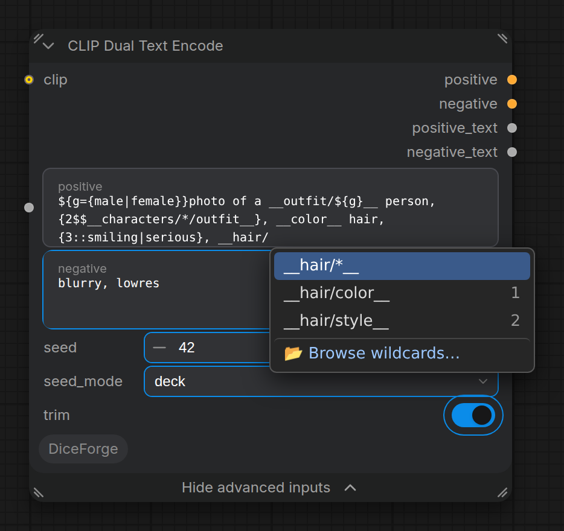

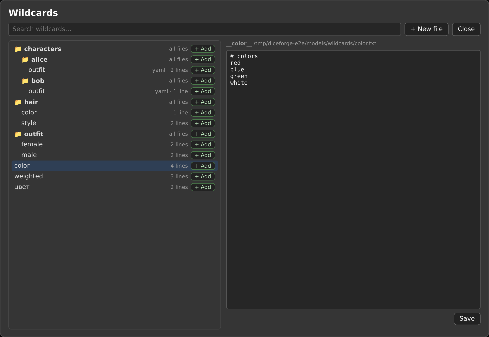

- **Autocomplete:** type `__` in the positive or negative field and a list of the wildcard files (with their number of lines) and folders (`folder/*`) opens at the cursor. Keep typing to filter it; ↑/↓ to move, Enter or Tab to insert, Esc to close. The last entry, *📂 Browse wildcards…*, opens the browser.
- **Wildcard Browser:** right-click the node → *🎲 Wildcard Browser*. It shows the wildcard folders as a tree, with the number of lines of each file and its first lines as a tooltip, and a search box. Folders start closed: click a folder's name to open or close it, or use **Expand all** and **Collapse all**. The browser remembers which folders are open; a search shows every match with its folders open, and opening a file opens its folders.
  - **+ Add** next to a file inserts `__name__`, next to a folder `__folder/*__`, where the cursor was last in the node's positive or negative field (at the end of the positive prompt if you have not clicked in one yet). Commas are added when the name would touch other text.
  - **+ New file** creates a file (`hair/color` makes the `hair` folder too) in the first wildcards folder. A name that is already taken is refused, so an existing file is never emptied.
  - Click a file name to open it in the editor on the right, change its lines and **Save** (or Ctrl+S). *Save •* means there are unsaved changes. As in a code editor, every line has its number on the left and a thin line under it, the line with the caret is highlighted, and the syntax is colored as in the prompt fields (with `#` comment lines and `3::` line weights); long lines scroll sideways instead of wrapping, so a number always belongs to one option.
  - **☆** next to a file makes it a favorite (★); **★ Favorites** in the toolbar shows only the favorites, in open folders. In the `__` autocomplete, favorites come first (after the names that start with what you typed) and are marked ★. They are kept in `ComfyUI/user/DiceForge/wildcard_favorites.json` and follow a rename or move; a yaml wildcard can be a favorite too.
  - **⇄ Move** moves the open file to another folder: pick a folder (or the top folder) or type a new one. Dragging a file onto a folder in the tree does the same (onto the empty part of the tree for the top folder). Unsaved changes stay in the editor.
  - **Rename** gives the open file a new name or moves it: `hair/color` to `palette/hair` moves it to the `palette` folder. It stays in its wildcards folder, and a name that is already taken (by a file or a yaml wildcard) is refused. Prompts that use the old `__name__` need the new one.
  - **Delete** removes the open file, after a confirmation. Folders left empty by a rename or delete are removed too.
  - Wildcards from yaml files are shown read-only: edit, rename or delete them in their yaml file.
- Both work in the Nodes 2.0 and the classic node design.

Example `color.txt`:

```text
# colors for __color__
crimson red
deep {navy|royal} blue
emerald green
3::black
```

Example `characters.yaml`, giving `__characters/alice/outfit__`, `__characters/alice/hair__` and `__characters/bob/outfit__` (and `__characters/*/outfit__` for both outfits):

```yaml
characters:
  alice:
    outfit:
      - blue dress
      - "3::white apron"
    hair: [blonde hair, "{long|short} hair"]
  bob:
    outfit: [jeans, hoodie]
```

In YAML, put quotes around a line that starts with `{`, `[`, `!` or contains `: ` or ` #`, as above; otherwise YAML reads it as something else.

#### Notes

- Choices and wildcards are filled in by the node, from its `seed`, not by the ComfyUI frontend. The saved workflow keeps the prompts with `__name__` and `{a|b}`, and the same seed gives the same result again.
- Positive and negative are filled in from the same seed, one after the other, so the same wildcard can pick different lines in each.

### Tag autocomplete (Danbooru, e621)

Anime models (Illustrious, NoobAI, Anima, Pony) were trained on Danbooru tags: written the way the model knows them, a tag works much better. While you type a word in a prompt field, the node suggests the most used tags that start with it, or with one of their aliases (`miku → hatsune_miku`), with how often each is used (👤 characters, 🎨 artists, ©️ series). **Enter** or **Tab** puts the tag in as the models learned it: spaces for underscores (emoticons like `^_^` keep theirs), parentheses escaped (`\(`), and a comma after it.

- The tag lists come from [a1111-sd-webui-tagcomplete](https://github.com/DominikDoom/a1111-sd-webui-tagcomplete): right-click CLIP Dual Text Encode → **🏷 Tag autocomplete** → **⬇ Download: Danbooru** (about 100,000 tags) or **e621** (furry models). Download again to update a list.
- They are kept in `ComfyUI/user/DiceForge/tags` in that project's CSV format (`tag,type,count,aliases`); any list in that format can be put there by hand. Every list there is used.
- Turn it off in ComfyUI's settings: *DiceForge → Prompts → Tags*.

### Tag Browser

Right-click CLIP Dual Text Encode and choose **🏷 Tag Browser** to look through the downloaded tag lists:

- **Search** by name or alias (spaces or underscores), most used first (or by name); tags that start with what you typed come first.
- **Types**: General, 👤 Characters, ©️ Series, 🎨 Artists, ⚙️ Meta, and your **★ Favorites** (☆ next to a tag stars it; kept in `ComfyUI/user/DiceForge/tag_favorites.json`).
- **+ Add** puts the tag where the cursor was last in the node's prompts (as the autocomplete writes it: spaces, escaped parentheses), **− Neg** at the end of the negative prompt, **↗** opens it on Danbooru.
- 100 tags at a time; **Show more** loads the next ones.

### Prompt styles

Right-click CLIP Dual Text Encode and choose **🎨 Prompt styles**: named pieces of positive and negative prompt, put in with one click, as A1111's styles. A style already in the prompts is marked ✓, and a second click takes it out again.

| Built-in style | Positive (before your prompt) | For |
|---|---|---|
| **Illustrious quality** | `masterpiece, best quality, amazing quality, very aesthetic, absurdres` | Illustrious XL and its merges |
| **NoobAI quality** | `masterpiece, best quality, newest, absurdres, highres` | NoobAI-XL |
| **NoobAI v-pred quality** | the same, plus `very awa` | NoobAI-XL v-pred |
| **Anima quality** | `masterpiece, best quality, score_8, newest` | Anima |

Each also puts the usual negative for its family after your negative prompt (`lowres, worst quality, bad quality, bad anatomy…`).

- **✨ Auto** puts in the style of the model connected to the node's `model` input, by its Civitai base model (from [Model info](#model-info)) or its file name, as [KSampler presets](#ksampler-presets) do.
- **💾 Save the prompts as a style…** saves the node's two prompts under a name; **🗑 Delete** removes one. Write `{prompt}` where your prompt goes (`{prompt}, film grain, 35mm`); without it the style goes after the prompt.
- Your styles are kept in `ComfyUI/user/DiceForge/styles.csv`, in A1111's format (`name,prompt,negative_prompt`): an A1111 or Forge `styles.csv` can simply be copied there.

### Danbooru Tag Enhancer

A node that makes a few tags a full prompt from a real Danbooru post: type `1girl, hatsune miku` and get, for example, `1girl, hatsune miku, twintails, smile, thighhighs, looking at viewer, holding microphone…`, the tags of a picture that has yours, the way the anime models (Illustrious, NoobAI, Pony, Anima) learned them.

1. Type the tags in `tags`, or connect `positive_text` of a CLIP Dual Text Encode (choices and wildcards filled in); weights, `\(` escapes and `<lora:>` tags are read through.
2. Connect `text` to CLIP Dual Text Encode's `positive` (or another text encoder). `added_tags` has only the added ones, `post_url` the post they came from.
3. Every run takes a new post, like Danbooru's [random post](https://danbooru.donmai.us/posts/random). The node shows the prompt it made under its inputs, with the added tags and a link to the post: click the text to copy it, and paste a prompt you like into `tags` (or a CLIP Dual Text Encode) to keep it. It runs also with nothing connected, just to see prompts.

How it picks:

- Danbooru picks a random post (`/posts/random`) with the two most telling of your tags and your `rating` (a search without an account may have two tags; the rating is free): with the [tag lists](#tag-autocomplete-danbooru-e621) downloaded, the rarest tags Danbooru knows, characters and series first (`hatsune miku` before `1girl`), and tags it doesn't know (`masterpiece`) are left out; without the lists, or when they know none of your tags, your first two. Under the prompt the node shows what it searched (`Searched: blue_archive rating:g`). When no post has both, each tag alone.
- `rating`: `general` posts only (the default), or also `sensitive`, `questionable`, or any.
- From that post, its general tags that your prompt lacks are added (characters, series and artists too, if you turn them on under Advanced), the most used first, at most `max_tags` (15; 0 for all), without the `exclude` list (signature, watermark, speech bubble…), `after` or `before` your tags, written as the models learned them (spaces, escaped parentheses).
- It needs Danbooru: offline, the node says so.

## Image sizes

### SDXL Resolution List (Latent)


Node id: `SDXLResolutionListLatent`.

The resolution is a nested list: first pick a group in `resolution`, then a size of that group in `size`. The Random Chaos group also shows `max_aspect`.

#### Inputs

| Input | Section | Default | Description |
|---|---|---|---|
| `resolution` | main | `Standard` | Group: `Standard`, `High-Res`, `Random` or `Random Chaos` (see below). |
| `size` | main | `1024 x 1024` | A size of the chosen group: a fixed size for Standard and High-Res, a list to pick from for Random, an orientation for Random Chaos (`Any`, `Portrait` or `Landscape`). |
| `max_aspect` | main (Random Chaos only) | `2.0` | The most stretched aspect ratio Random Chaos may pick (1.0–4.0): 2.0 means up to 2:1 or 1:2, 1.0 gives only squares. |
| `preview` | main | — | Live preview of the output size and megapixels, the same widget as in the core *Resolution Selector*. For the Random and Random Chaos groups it shows the size of the last run, as long as the settings other than `seed` stay the same, and "—" before a run or after a change. |
| `seed` | main | `0` | Seed for the random options. The same seed always gives the same size. |
| `rescale` | main | `by percentage` | Rescales the picked size, like the HiresFix node of Easy-Use. The input under it depends on the mode (below). Then the size is rounded to `multiple`, taking the nearby multiples closest to the exact aspect ratio. Workflows saved with the earlier `scale` number open with `by percentage` (scale 1.5 becomes 150). |
| `percent` | main (*by percentage*) | `100` | Each side in percent (5–1000): `150` turns 1024x1024 into 1536x1536, `50` into 512x512. The number of pixels (megapixels) grows by its square: `150` gives 2.25 times the pixels, `200` four times. |
| `width`, `height` | main (*to Width/Height*) | `1536`, `0` | A width and/or a height. With one of them `0`, the other side follows the aspect ratio (width 1536: 1216x832 becomes 1536x1048); with both set, exactly that size, whatever size was picked; with both `0`, the size stays as picked. |
| `longer_side` | main (*to longest side*) | `1536` | The longest side, keeping the aspect ratio: 1216x832 becomes 1536x1048 and 832x1216 becomes 1048x1536. Good for random sizes: every size ends up with the same longest side. |
| `multiple` | Advanced | `8` | Rounds width and height to the nearest multiple of this value (8–256, in steps of 8). Use 64 for SDXL training sizes. |
| `batch` | Advanced | `1` | Number of latents in the batch (1–32). |
| `seed_mode` | Advanced | `random` | How the random groups change from run to run: `random`, `deck`, `shuffle`, `balanced` or `sequential`. See [Seed modes for sizes](#seed-modes-for-sizes). |

#### Outputs

| Output | Description |
|---|---|
| `latent` | Empty latent batch, identical to what **Empty Latent Image** makes for this size and `batch`. Connect it to the `latent_image` input of **KSampler**. |
| `width` | Width in pixels, for example for an upscale or hires-fix step. |
| `height` | Height in pixels. |
| `seed` | The seed used for this run, the same as the node's `seed` input. For example, connect it to the `seed` input of **KSampler**. |

#### Fixed sizes

The `size` list shows width x height; the aspect ratios are given here for reference.

| Standard | High-Res |
|---|---|
| 1024 x 1024 (1:1) | 1536 x 1536 (1:1) |
| 1152 x 896 (9:7) / 896 x 1152 (7:9) | 1536 x 1152 (4:3) / 1152 x 1536 (3:4) |
| 1216 x 832 (3:2) / 832 x 1216 (2:3) | 1536 x 1024 (3:2) / 1024 x 1536 (2:3) |
| 1344 x 768 (16:9) / 768 x 1344 (9:16) | 1536 x 864 (16:9) / 864 x 1536 (9:16) |
| 1536 x 640 (21:9) / 640 x 1536 (9:21) | |

#### Random groups

- **Random**: picks one of the listed sizes at random from the seed.
  - **Any Listed / Any High-Res Listed**: one of the Standard or High-Res sizes above.
  - **Vertical Listed / Horizontal Listed** (and their **High-Res** versions): only portrait or only landscape sizes.
- **Random Chaos**: a random aspect ratio up to `max_aspect`, at about 1024x1024 pixels (the SDXL native size), then rescaled like the other groups: by percentage 150 gives about 1536x1536 pixels (2.25 MP), to longest side 1536 gives a longest side of exactly 1536.
  - **Any**: wide or tall, equally likely (the ratio is picked evenly in log scale).
  - **Portrait / Landscape**: only taller than wide, or only wider than tall; never a square. When the size would round to a square, the shorter side steps down one `multiple`; if `rescale` sets that side (or it is already the smallest), the longer side steps up instead. What `rescale` sets is kept: an exact size (`to Width/Height` with both sides) or a longest side at the smallest `multiple` can be a square.
  - The size rounds down to `multiple`, so it never exceeds its rescaled budget (it lands at about 0.9–1.0 of that).

#### Notes

- Rounding to `multiple` applies to fixed sizes too. With the default 8 every listed size stays exact; with 64, 864 becomes 896.
- Like any `seed` input, it gets the frontend's *control after generate* option, which is *randomize* by default, so the random options give a new size on each run. Set it to *fixed* to keep the same size.

### Resolution Selector (Random, Latent)

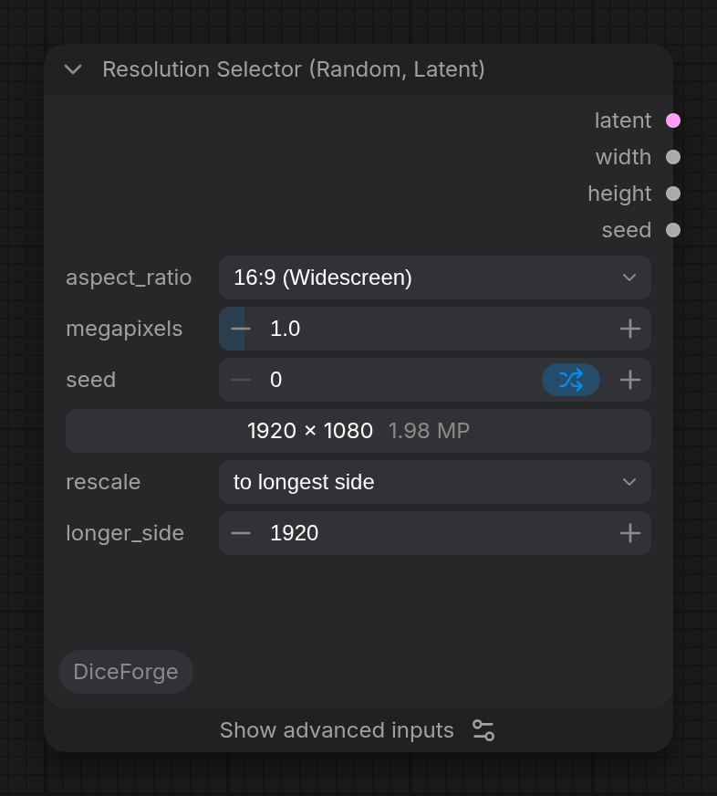

Node id: `ResolutionSelectorRandomLatent`.

It works like the core ComfyUI *Resolution Selector* followed by **Empty Latent Image**, using the same size calculation, and adds random aspect ratios. For fixed ratios, the size is identical to the core node's.

#### Inputs

| Input | Section | Default | Description |
|---|---|---|---|
| `aspect_ratio` | main | `1:1 (Square)` | A fixed ratio, or one of the random options below. |
| `megapixels` | main | `1.0` | Target total size (0.1–16). 1.0 MP = 1024x1024 for a square. |
| `preview` | main | — | Live preview of the output size and megapixels. For random options it shows the size of the last run, as long as the settings other than `seed` stay the same, and "—" before a run or after a change. |
| `seed` | main | `0` | Seed for the random options. By default it is randomized after each run (*control after generate*), so every run gets a new random ratio. Set it to *fixed* to repeat a result. |
| `multiple` | Advanced | `8` | Rounds width and height to the nearest multiple of this value (8–256, in steps of 8). Use 64 for SDXL training sizes. Random Chaos rounds down. |
| `batch` | Advanced | `1` | Number of latents in the batch (1–32). |
| `max_aspect` | Advanced | `2.0` | Random Chaos only: the most stretched ratio allowed (1.0–4.0). 2.0 means up to 2:1 or 1:2. |
| `seed_mode` | Advanced | `random` | How the random options change from run to run, as in SDXL Resolution List. See [Seed modes for sizes](#seed-modes-for-sizes). |
| `rescale` | main | `by percentage` | Rescales the size calculated from `aspect_ratio` and `megapixels`, with the same modes as in [SDXL Resolution List](#sdxl-resolution-list-latent): `percent` of each side (150: 1:1 at 1 MP becomes 1536x1536), a `width` and/or `height` (0 follows the aspect ratio), or the `longer_side` (16:9 with 1920 becomes 1920x1080). Then each side is rounded to `multiple`. At 100% the size is exactly what it was without rescale, and workflows or API prompts made before it get 100%. |

#### Outputs

| Output | Description |
|---|---|
| `latent` | Empty latent batch, identical to what **Empty Latent Image** makes for this size and `batch`. Connect it to the `latent_image` input of **KSampler**. |
| `width` | Width in pixels, for example for an upscale or hires-fix step. |
| `height` | Height in pixels. |
| `seed` | The seed used for this run, the same as the node's `seed` input. For example, connect it to the `seed` input of **KSampler**. |

#### Aspect ratios

1:1, 2:3, 3:2, 3:4, 4:3, 7:9, 9:7, 9:16, 16:9, 9:21, 21:9.

#### Random options

- **Random Any / Random Portrait / Random Landscape**: one of the listed ratios (any, only portrait or only landscape), each equally likely.
- **Random Chaos Any / Random Chaos Portrait / Random Chaos Landscape**: any ratio up to `max_aspect`. Wide and tall ratios are equally likely.

#### Notes

- Fixed and Random ratios round to the nearest `multiple`, like the core node, so the size can be slightly above or below `megapixels` (about 0.94–1.06 at 1.0 MP).
- Random Chaos rounds down, so it never exceeds `megapixels` (it lands at about 0.9–1.0 of it), and Random Chaos Portrait/Landscape never return a square (unless `rescale` sets a square size, as in SDXL Resolution List).

### Seed modes for sizes

Both resolution nodes (and [Random Int and Random Float](#random-int-and-random-float) and the [random loaders](#random-lora-random-checkpoint-random-diffusion-model-and-random-vae)) have a `seed_mode` input (Advanced) for their random options, with the same modes as [CLIP Dual Text Encode](#seed-modes). Fixed sizes and ratios ignore it.

| Mode | Listed sizes and ratios | Seed |
|---|---|---|
| `random` | Every pick is random, so a size can come up twice in a row. Same as before seed modes existed. | The same seed gives the same size. |
| `deck` | The seed is a position in a shuffled order: with *control after generate* on *increment*, every size comes once per round (9 runs for Any Listed), then a new order. | The same seed gives the same size. |
| `shuffle` | Like shuffle in a music player: the node remembers which sizes were used and picks from the rest with each new seed (*increment* or *randomize*). | The same seed gives the same size again. |
| `balanced` | A size that just came up gets a low chance, and the longer one is missed, the higher its chance: repeats are rare but possible. | The same seed gives the same size again. |
| `sequential` | The seed is the position in the list: seeds 0, 1, 2… go through the sizes in order, then start over. | The same seed gives the same size. |

**Random Chaos** has no list, so the modes other than `random` split the aspect range into 8 equal parts (4 for Portrait or Landscape), take turns between the parts as above, and pick a random ratio inside the part. Runs then cover tall, square-ish and wide shapes evenly: in 8 runs about 8 of the 8 parts, against about 5 with `random`. `sequential` takes the middle of each part in order, sweeping from the tallest to the widest shape (at 1 MP and `max_aspect` 2.0: 752x1384, 824x1264 … 1384x752).

`shuffle` and `balanced` keep their memory in the same [memory file](#memory-file) as CLIP Dual Text Encode, so they continue after a restart.

### About the latent

Like the output of **Empty Latent Image**, the latent works with any model you would use that node with: the core samplers adapt an empty latent to the model's latent format.

## Random nodes

### Random Int and Random Float

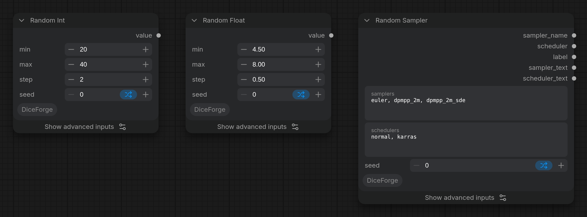

A random number between `min` and `max`, picked from the seed with the same [seed modes](#seed-modes-for-sizes) as the resolution nodes, so values can go through the whole range instead of clustering. Connect the `value` output to any number input (converted to an input), for example KSampler's `cfg` or `steps`.

#### Inputs

| Input | Where | Default | Description |
|---|---|---|---|
| `min` | main | `0` | The smallest value. |
| `max` | main | `10` (Int), `1.0` (Float) | The largest value. A reversed range (`min` above `max`) works too. |
| `step` | main | `1` (Int), `0` (Float) | Only `min`, `min + step`, `min + 2 x step`… up to `max`. For Random Float, `0` means any value; for example `min` 5, `max` 8, `step` 0.5 gives CFG 5.0, 5.5 … 8.0. |
| `seed` | main | `0` | Seed for the random value. With `deck` or `sequential`, set *control after generate* to *increment*. |
| `seed_mode` | Advanced | `random` | `random`, `deck`, `shuffle`, `balanced` or `sequential`, as for the resolution nodes. |
| `parts` | Advanced (Float) | `10` | With `step` 0: how many equal parts of the range the modes other than `random` take turns between. |

#### Outputs

| Output | Description |
|---|---|
| `value` | The random value (`INT` or `FLOAT`). |

#### How the modes pick numbers

- **Values on a step** (every Random Int, Random Float with `step` above 0): each possible value is an option, like a size in a list. `deck` and `shuffle` give every value once before any repeats (1 to 6: six runs, six different values), and `sequential` counts up from `min` by `step`, then starts over.
- **More than 1000 possible values** (for example 0 to 1,000,000): `deck`, `shuffle` and `balanced` take turns between 100 equal parts of the range instead, with a random value inside the part, so 100 runs land in 100 different parts. `sequential` still counts up.
- **Random Float with `step` 0**: the range is split into `parts` equal parts, like Random Chaos: in 10 runs over 0–1, `deck` and `shuffle` hit all 10 tenths (about 7 with `random`). `sequential` gives the middle of each part in order (0.05, 0.15 … 0.95).
- The value is written to the console on every run.

### Random LoRA, Random Checkpoint, Random Diffusion Model and Random VAE


Loaders that pick the file from a folder with the [seed modes](#seed-modes-for-sizes), then load it with the core loader (**Load LoRA**, **Load Checkpoint**, **Load Diffusion Model**, **Load VAE**), so the result is the same as picking that file by hand.

| Input | Where | Description |
|---|---|---|
| `folder` | main | A folder in `models/loras`, `models/checkpoints`, `models/diffusion_models` or `models/vae`, subfolders included; `(all)` for every file. After adding folders, refresh the node definitions (**R**). |
| `seed` | main | Seed for the pick. With `deck` or `sequential`, set *control after generate* to *increment*. |
| `seed_mode` | Advanced | `random`, `deck`, `shuffle`, `balanced` or `sequential`, as for the resolution nodes. `sequential` goes through the files sorted by name. |
| `model`, `clip` | Random LoRA | The model and CLIP to apply the LoRA to. `clip` is optional: leave it unconnected to change only the model. |
| `strength_model`, `strength_clip` | Random LoRA | As in **Load LoRA**. Connect **Random Float** to them to vary the strength too. |
| `include_none` | Random LoRA, Advanced | Adds "no LoRA" as one more option, so some runs use the model as it is. |
| `weight_dtype` | Random Diffusion Model, Advanced | As in **Load Diffusion Model**. |

Each loader outputs what its core loader does (`model`, `clip`, `vae`) plus the picked file name (`lora_name`, `ckpt_name`, `model_name`, `vae_name`; empty for "no LoRA"), for example to put it in the image file name. The picked file is also written to the console.

- Adding or removing files in the folder makes the node pick again, and `deck`, `shuffle` and `balanced` start a new round for the new list.
- An empty folder stops the run with an error that names it.
- With `deck` and *increment*, a checkpoint comparison shows every checkpoint once before any repeats; with `shuffle` it continues after a restart.

### Random Image


Like **Load Image**, but the image is picked from a folder with the [seed modes](#seed-modes-for-sizes): with `deck` and *increment* an img2img or ControlNet series goes through every image once before any repeats. After each run the node shows the picked image, its file name (click to copy), size (and frames of an animated one), folder, and the seed and mode it came from; click the image to open it full size. The preview is kept with the workflow, so it is still there after a reload, and it also updates when the node comes from ComfyUI's cache. A file of the input folder is shown from there; one from `path` through a temporary copy, which ComfyUI clears on restart (the preview then says to run again).

| Input | Where | Description |
|---|---|---|
| `folder` | main | A folder in `ComfyUI/input`, subfolders included; `(all)` for every image in `input` (the mask editor's `clipspace` folder is left out). After adding folders, refresh the node definitions (**R**). |
| `seed` | main | Seed for the pick. With `deck` or `sequential`, set *control after generate* to *increment*. |
| `seed_mode` | Advanced | `random`, `deck`, `shuffle`, `balanced` or `sequential` (files sorted by name). |
| `path` | Advanced | Any folder on this computer instead, for example `D:/refs/poses` (subfolders included). Empty: use `folder`. |

| Output | Description |
|---|---|
| `image` | The picked image; all frames for an animated GIF or WebP, as in Load Image. |
| `mask` | The mask from the alpha channel (1 where transparent), as in Load Image. |
| `file_name` | The picked file, relative to the folder. |

- Supported files: png, jpg, jpeg, webp, bmp, gif, tif, tiff.
- The image is loaded with the same steps as Load Image, and gives the same result. When ComfyUI's video reader fails on a file (it does on some WebP files, and then Load Image fails too), Random Image reads it with Pillow instead.
- Adding, removing or editing images in the folder makes the node pick again.

### Random Sampler

Picks a sampler and scheduler pair for **KSampler** (or **KSampler Advanced**) from the ones you list. Every listed sampler is paired with every listed scheduler, and each pair is one option of the [seed modes](#seed-modes-for-sizes): with `deck` or `sequential` and *increment*, a series tries every pair once.

| Input | Where | Description |
|---|---|---|
| `samplers` | main | Samplers to pick from, separated by commas or new lines, with the names of KSampler's list (`euler, dpmpp_2m, dpmpp_2m_sde`...). `*` for every sampler. An unknown name stops the run with the list of known ones. |
| `schedulers` | main | Schedulers to pick from, the same way (`normal, karras`...). `*` for every scheduler. |
| `seed` | main | Seed for the pick. With `deck` or `sequential`, set *control after generate* to *increment*. |
| `seed_mode` | Advanced | `random`, `deck`, `shuffle`, `balanced` or `sequential` (each sampler with every scheduler, in the listed order). |

| Output | Description |
|---|---|
| `sampler_name` | Connect to KSampler's `sampler_name`. |
| `scheduler` | Connect to KSampler's `scheduler`. |
| `label` | `"sampler / scheduler"`, for the `label` of **Dice Grid**. |
| `sampler_text`, `scheduler_text` | The two names as text, for an XY **Dice Grid** (`row_label` and `label`). |

To vary only the sampler, list one scheduler (and the other way round).

## Sampling and upscaling

### KSampler presets

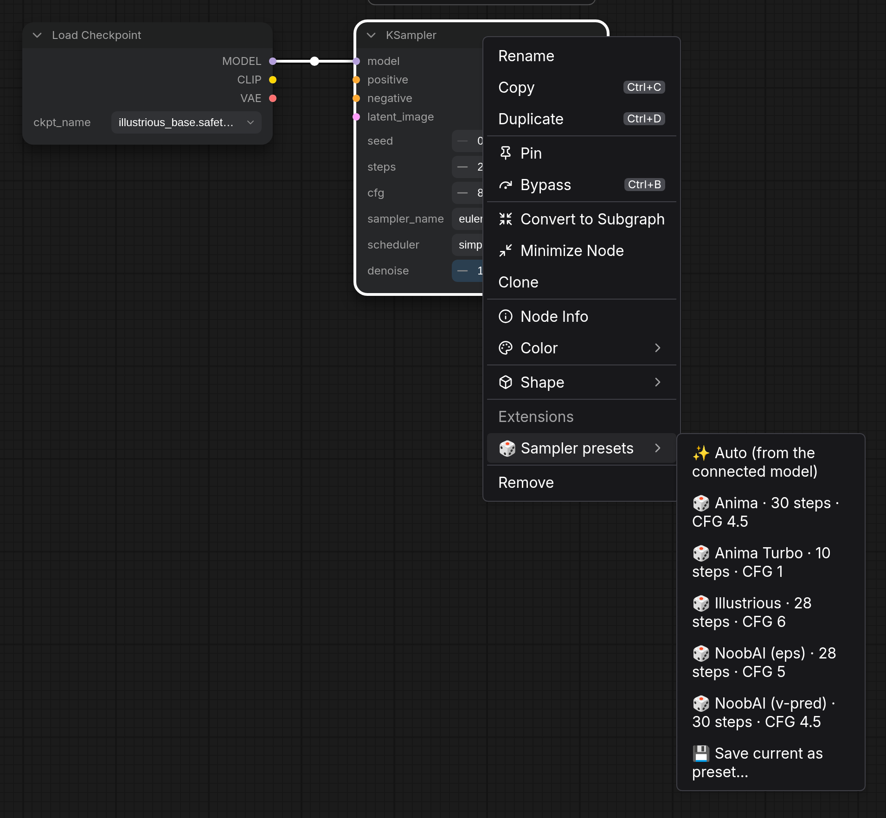

Right-click **KSampler**, **KSampler (Advanced)** or any other node with `steps`, `cfg`, `sampler_name` and `scheduler`, and choose **🎲 Sampler presets**. A preset sets those four widgets at once; the seed, denoise and the rest stay as they are. A message says what was set.

| Preset | Steps | CFG | Sampler | Scheduler | For |
|---|---|---|---|---|---|
| **Anima** | 30 | 4.5 | er_sde | simple | Anima base and aesthetic: 30-50 steps, CFG 4-6. `euler_ancestral` gives softer images. |
| **Anima Turbo** | 10 | 1 | euler | simple | The distilled Anima: CFG 1, 8-12 steps. |
| **Illustrious** | 28 | 6 | euler_ancestral | normal | Illustrious XL and its merges: 20-30 steps, CFG 5-7. |
| **NoobAI (eps)** | 28 | 5 | euler_ancestral | normal | NoobAI-XL epsilon versions. |
| **NoobAI (v-pred)** | 30 | 4.5 | euler | normal | NoobAI-XL v-prediction: Euler only (other samplers and Karras don't work well with it). A checkpoint not marked as v-pred needs **ModelSamplingDiscrete** (`v_prediction`) in front of KSampler. |

- **✨ Auto** picks the preset for the model connected to the sampler's `model` input. It follows the connection back through LoRA loaders and other nodes in between to Load Checkpoint or Load Diffusion Model. It uses the model's Civitai base model from [Model info](#model-info), and falls back to the file name: *anima*, *turbo*, *noob*, *vpred* / *v-pred*, *illustrious*, *ilxl*. For any other model it says that it doesn't know one, and changes nothing.
- **💾 Save current as preset…** saves the node's four values under a name of your choice. Your presets come after the built-in ones (★); **🗑 Delete** removes one. They are kept in `ComfyUI/user/DiceForge/sampler_presets.json`, so every workflow has them. The built-in names can't be reused.
- A sampler or scheduler that your ComfyUI doesn't have is left unchanged, and the message names it.

### Variation Seed

Variations of a picture, as A1111's *variation seed* (subseed): the same composition with small differences. KSampler starts from noise made from its seed; Variation Seed blends that noise with the noise of a second seed, the variation seed, by `variation_strength`. The blend is spherical (slerp), so the noise keeps the size the model expects.

1. Put it on the model line, right before KSampler: the loader's (or LoRA Stack's) `model` in, its `model` out to KSampler.
2. Set KSampler's seed to the picture you like and its *control after generate* to *fixed*.
3. Set Variation Seed's *control after generate* to *increment* and queue: every run is another variation. Connect `label` to Dice Grid to see them side by side, and keep the best with ★.

| `variation_strength` | What changes |
|---|---|
| `0` | Nothing: KSampler's seed's own picture. |
| `0.05`–`0.15` | The same pose, composition and character; other folds, strands of hair, background details, expression. |
| `0.2`–`0.4` | Visibly different details; the picture is still recognizable. |
| `1` | The variation seed's own picture. |

- Reproducible: the same seed, variation seed and strength always give the same picture.
- It works with the plain KSampler for every model (SD 1.5, SDXL, Illustrious, NoobAI eps and v-pred, Pony, Flux, Anima…), since it changes the noise the sampling starts from, not the latent: flow models (Flux, Anima, Qwen) don't read the latent at full denoise.
- With several Variation Seed nodes in a row, the last one counts.
- [XY Plot](#xy-plot) has `variation seed` and `variation strength` axes: a grid of variations of one picture (with `variation_strength` 0.1 under Advanced), or of strengths.

### Hires Fix

The second pass of a hires fix in one node: the latent of the first KSampler is made bigger, then sampled again at a low `denoise`, so the bigger image gets new detail instead of blur.

1. Connect the first KSampler's `LATENT` to `samples`, and `model`, `positive` and `negative` as for the first KSampler.
2. Set the size: `upscale_by` (1.5: 1024×1024 becomes 1536×1536), or `width` and `height`. To take the size from DiceForge, connect `width` and `height` of a second SDXL Resolution List or Resolution Selector with `rescale` (the same size as the first, at 150%, or to a longest side).
3. Decode `latent` with VAE Decode (+ Save), or connect `vae` and use the `image` output.

| Input | Default | Description |
|---|---|---|
| `upscale_by` | `1.5` | Each side times this, when `width` and `height` are 0. |
| `width`, `height` | `0` | The size of the second pass; one of them alone keeps the aspect ratio. Rounded to multiples of 8. |
| `upscale_method` | `bislerp` | How the latent is made bigger (`nearest-exact`, `bilinear`, `area`, `bicubic`, `bislerp`). |
| `seed`, `steps`, `cfg`, `sampler_name`, `scheduler` | `15` steps, CFG `6` | The second pass's settings. Connect the first pass's seed for the same noise, or XY Plot's outputs. |
| `denoise` | `0.45` | How much the second pass changes: 0.3–0.5 adds detail and keeps the picture. A latent upscale needs about 0.5 or more; with an upscale model, less is enough. |
| `vae` | | Optional: for `upscale_model`, and for the `image` output. |
| `upscale_model` | | Optional: an upscale model (**Load Upscale Model**: ESRGAN, 4x-UltraSharp…). The image is made bigger in pixels with it (sharper than a latent upscale), resized to the second pass's size, and encoded again. Needs `vae`. |

Outputs: `latent`, `image` (only with `vae`), `width` and `height` of the second pass. The console shows the sizes and settings of each run.

### HiresFix (Load VAE)

Like Easy-Use's *HiresFix*, with the VAE picked from a list instead of a `vae` input: the image of the first pass is made bigger with an upscale model, rescaled, shown or saved, and encoded into a latent for a second KSampler pass (denoise 0.3–0.5). Where [Hires Fix](#hires-fix) does the second pass itself, this node prepares the image and the latent for your own KSampler.

| Input | Default | Description |
|---|---|---|
| `image` | | The image of the first pass (VAE Decode, or VAE Decode + Save's `images`). |
| `model_name` | the first model | An upscale model from `models/upscale_models` (ESRGAN, 4x-UltraSharp, AnimeSharp…), or `None` to only rescale. |
| `rescale_after_model` | on | Rescale the upscaled image (below); off keeps the model's size (4× for a 4x model). Without a model the image is always rescaled. |
| `rescale_method` | `lanczos` | How the image is resized: `nearest-exact`, `bilinear`, `area`, `bicubic`, `lanczos`. |
| `rescale` | `by percentage` 50 | Of the image after the model: `percent` (a 4x model at 50% gives twice the size), `to Width/Height` (one of them keeps the aspect ratio), or `to longest side`. Rounded to multiples of 8 for the latent. |
| `crop` | `disabled` | With an exact width and height of another aspect ratio: `disabled` stretches, `center` crops. |
| `vae_name` | | The VAE that encodes the image, from the same list as Load VAE; kept loaded while the name stays the same. |
| `image_output` | `Preview` | `Hide`, `Preview`, `Save` or `Hide&Save`, as in Easy-Use. |
| `filename_prefix` | `DiceForge/hires` | Advanced: where `Save` puts the image. |

Outputs: `image` (upscaled and rescaled), `latent` (encoded with the VAE: connect it to a KSampler with denoise 0.3–0.5) and `vae` (for that KSampler's VAE Decode).

## Comparing results

### XY Plot

An X/Y comparison in one node. Each run gives **KSampler** the settings of one cell and **Dice Grid** its labels; **▶ Queue** on the node queues a run for every cell.

How to connect it:

1. Connect `seed`, `steps`, `cfg`, `sampler_name`, `scheduler` and `denoise` to KSampler (drag each onto KSampler's field of the same name). For a LoRA axis, put XY Plot between the loader and KSampler: `model` and `clip` in, `model` and `clip` out (to KSampler and the prompt encoder).
2. Connect `x_label` to Dice Grid's `label`, `y_label` to `row_label`, and `count`, `columns` and `new_grid` to the Dice Grid fields of the same name. Dice Grid then starts a fresh grid on the first cell, and saves it after the last one with the values as column and row headers.
3. Pick what changes on X and on Y and type the values. The node shows the headers and the number of images; click **▶ Queue N images** (click again to stop queueing).

| Axis | Values | Example |
|---|---|---|
| `seed`, `steps` | Whole numbers and ranges | `1, 2, 3` · `20-40:10` |
| `cfg`, `lora strength`, `denoise` | Numbers and ranges `start-end:step` (step 1 unless given) | `4, 5.5, 7` · `3.5-7:0.5` · `-1..1:0.5` |
| `sampler`, `scheduler` | Names from KSampler's lists, `*` for all | `euler, dpmpp_2m` |
| `lora` | LoRA files, with or without folder and extension; patterns; `None` for the image without a LoRA | `style/*, None` · `ink` |
| `variation seed`, `variation strength` | As [Variation Seed](#variation-seed): seeds (`1-8`), strengths (`0-0.3:0.05`); the other one is set under **Advanced** (`variation_strength` 0.1 for a seed axis). Needs `model` connected, its output to KSampler. | `1-8` · `0, 0.05, 0.1, 0.2` |
| `none` | Nothing changes (Y `none`: one row of images) | |

- The other settings (`seed`, `steps`, `cfg`, `sampler_name`, `scheduler`, and under **Advanced** `denoise`, `lora_name`, `lora_strength`) are used for every cell, except the ones on an axis. With a `lora strength` axis, `lora_name` is the LoRA it changes.
- `index` is the cell of a run, row by row. **▶ Queue** sets it for each run and puts it back to 0; Run alone makes the cell at `index`.
- Up to 64 values per axis and 256 images in all. A field the node can't read is shown in red under it, and stops the run with the same message.
- Set KSampler's own *control after generate* to *fixed*, or connect `seed`: otherwise every cell gets another seed.

### Dice Grid

Collects the image of each run into a grid with labels, and saves the grid to the output folder when it is finished. Made for DiceForge series: connect the `lora_name`, `ckpt_name` or `file_name` output of a random loader to `label`, set the loader to `deck` with *increment*, and queue: after one round the grid holds every file once, with its name under it.

| Input | Where | Default | Description |
|---|---|---|---|
| `image` | main | | The image of this run. Every image of a batch (or frame of an animation) becomes a cell. |
| `label` | input | | Caption of the image. Model and image file names are shown without folder and extension (`anime/ink.safetensors` → `ink`). In an XY grid, the column. |
| `row_label` | input | | Connect it to make an XY grid: rows by `row_label`, columns by `label`, with headers. For example checkpoint × LoRA with `combinations`, or two loaders in `sequential`. |
| `count` | main | `0` | Images in a finished grid. `0`: the grid is finished when a label (or label pair) comes again, which is the end of a `deck` or `shuffle` round. |
| `columns` | main | `0` | Images per row; `0` makes the grid about square. XY grids take their columns from the labels. |
| `save` | main | on | Save each finished grid as a PNG in the output folder, with the workflow in it like **Save Image**. |
| `legend` | main | | Text in a block above or below the grid: a title, the settings that stay the same, or the prompt (connect `positive_text` of **CLIP Dual Text Encode**, which shows the prompt each grid was made with). |
| `numbered` | main | off | Numbers the images and lists their full labels in the legend (`1. very_long_style_name_v2`), for labels too long to fit under an image. XY grids keep their headers instead. |
| `cell_width` | Advanced | `384` | Width of each cell. Heights follow the aspect ratio, so images of different sizes (from the random resolution nodes) fit side by side. |
| `filename_prefix` | Advanced | `DiceForge/grid` | File name prefix of saved grids. |
| `name` | Advanced | `grid` | Grids are kept per node and name; another name starts a separate grid. |
| `new_grid` | Advanced | off | Starts a new grid with this image, dropping the unfinished one. Turn it off again for the next runs. |
| `legend_position` | Advanced | `top` | Where the legend goes: `top` or `bottom`. |

| Output | Description |
|---|---|
| `grid` | The grid so far, this run's image included (also shown on the node). |
| `cells` | Images in the grid so far. |

#### Keeping the best images

Under the node, the cells of the grid being made (or of the last finished one, until the next run starts a new grid) are shown small:

- Click a cell to star it (★); click again to unstar it.
- **💾 Save N kept** saves the starred ones at full size in `output/DiceForge/kept` (`kept_00001_<row>_<label>.png`), each with the workflow and prompt of its own run in it, like **Save Image**.
- **↺** on a cell opens the workflow of its run (its prompts and seeds included), as dropping its image on ComfyUI would: to make it again, or go on from it with Hires Fix.

- The cells wait between runs as small PNG files in `ComfyUI/user/DiceForge/grids`, not in RAM, so an unfinished grid survives a restart. Next to each is the image at full size with its run's workflow, for keeping; they go when the next grid starts.
- The node adds a cell on every run, even if nothing else changed, so queueing the same image twice adds it twice (and, with `count` 0 and a label, finishes the grid).

## LoRAs and models

### LoRA Stack

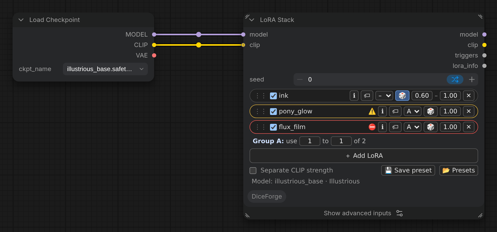

Node id: `DiceForgeLoraStack`. Several LoRAs in one node, like rgthree's *Power Lora Loader*, applied in order to the model and CLIP.

Each row: **⋮⋮** (drag to reorder), on/off, the LoRA (click its name to pick another one in the [LoRA Browser](#lora-browser)), **ℹ** ([Model info](#model-info)), **🏷** (trigger words), a **group**, **🎲**, the strength and **✕** (remove). **＋ Add LoRA** opens the LoRA Browser: **+ Add** adds a row, as many as you like. The browser starts on **Fits the model (…)**: the LoRAs made for the connected model's base, the same family (marked ⚠️, for example Pony LoRAs on an Illustrious model) and the ones not looked up on Civitai yet; LoRAs of another family are hidden. *All base models* in the filter shows every LoRA. The mouse wheel over a strength changes it by 0.05. A row whose file is missing is outlined in red.

- **Separate CLIP strength** (under the rows): each row gets a second strength (*C*) for the CLIP; otherwise the same strength is used for both.
- **🎲 Random strength:** the row gets two values, and each run picks a strength between them (in steps of 0.05) by the seed mode. With `deck` or `sequential` and *control after generate* on *increment*, 0.50–0.90 goes through all 9 strengths before repeating one. With a separate CLIP strength, the range is for the model strength only.
- **🏷 Trigger words:** which of the LoRA's trigger words go to the `triggers` output. The list shows the words you gave in Model info (*yours*) and Civitai's (*Civitai*); tick the ones you want, or type your own words (*added*). **Default** follows the LoRA's trigger words (yours, else Civitai's), also when they change; **None** adds no words from this LoRA. With your own choice the button shows the number of words (🏷3), with None it is struck through. The choice is kept in the row, so presets keep it too.
- **Groups (A–D):** the LoRAs of a group take turns. Under the rows, *Group A: use 1 to 1 of 3* sets how many of them each run uses (0 to all of them). Every set of LoRAs is one option of the seed mode, so `deck` or `shuffle` goes through every combination before repeating one: three style LoRAs with *use 1 to 2* give 6 combinations. LoRAs turned off do not take part.

| Input | Description |
|---|---|
| `model` | The diffusion model the LoRAs are applied to. |
| `clip` | Optional. The CLIP model they are applied to; unconnected, only the model changes. |
| `seed` | Seed for random strengths and groups. |
| `seed_mode` | Advanced. `random`, `deck`, `shuffle`, `balanced` or `sequential`, as in [Seed modes](#seed-modes). Without 🎲 and groups the seed changes nothing. |

| Output | Description |
|---|---|
| `model`, `clip` | With the LoRAs applied. |
| `triggers` | The trigger words of the LoRAs that were applied, as set with 🏷 (by default your own from Model info, else Civitai's; each word once), for example to connect to a text node or to put in CLIP Dual Text Encode. |
| `lora_info` | What was applied, for example `detail 0.65, style_b 1` (with the CLIP strength after a `/` when it differs), for a file name, a note or Dice Grid. |

**Base model check.** The node follows its `model` input back to the loader (**Load Checkpoint**, **Load Diffusion Model**, **Load Diffusion Model + CLIP**…, through nodes in between like other LoRA loaders or *Model Sampling*) and shows the model's base under the rows, for example *Model: waiNSFW · Illustrious*. Each LoRA's base is compared with it:

- **⚠️ (orange):** same model family, another base, for example a Pony LoRA on an Illustrious model. It may work, but not as well.
- **⛔ (red):** another family, for example a Flux or SD 1.5 LoRA on an SDXL-type model. It does not work.

Hover the sign for the details. The bases are the Civitai data of [Model info](#model-info): a model or LoRA that was never looked up (🔍 Civitai in its browser, or Model info) gets no warning, and the check never hashes anything by itself. It follows changes in the graph within a few seconds.

**Presets.** **💾 Save preset** saves the rows (strengths, 🎲 ranges, groups, separate CLIP) as a file in `ComfyUI/user/DiceForge/lora_presets`, named as you like. **📂 Presets** lists them:

- **Replace** puts a preset's rows in the node, instead of its rows; **+ Add** adds them after its rows.
- **⬇ File** downloads the preset file, to share it or keep a copy; **⬆ Import file…** reads preset files (several at once), and they appear in the list of every LoRA Stack.
- **🗑** deletes a preset.

A preset refers to the LoRAs by their file names in the loras folder: on another computer, a LoRA that is not there is outlined in red.

The rows are saved in the workflow (in the node's hidden `loras` input, as JSON). The node reads each LoRA file once and keeps it in memory while it is in the stack, and runs again when you change trigger words in Model info.

### Model info

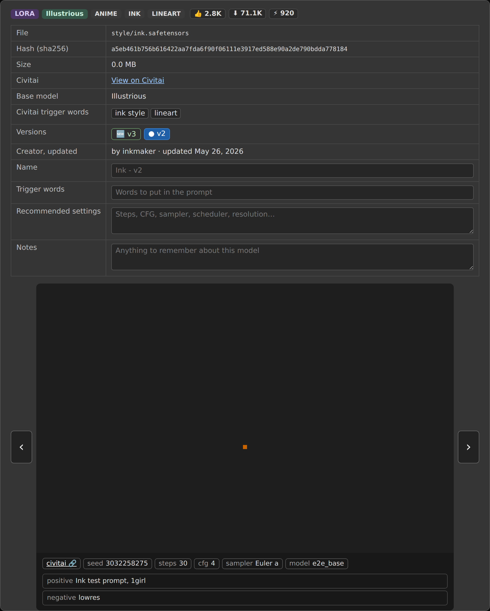

Right-click a node with a model file picked in a list (**Load Checkpoint**, **Load Diffusion Model**, **Load LoRA**, **Load VAE**, **Load CLIP**, **Load Diffusion Model + CLIP**, and custom nodes with such lists) and choose **🛈 Model info**. A dialog like rgthree's LoRA info opens, for every model kind:

- the file, its **sha256** and size;
- what **Civitai** knows about the file, found by its hash: the model and version name, type, base model, trigger words (click one to copy it) and a link;
- from the model's page on Civitai: its **tags**, the counts next to them (👍 likes, ⬇ downloads, ⚡ tips, 💬 comments), the **creator** and when the newest version came out, and the **versions**, newest first. Yours is marked ●, a newer one 🆕, and each opens its page. Civitai's public API has no bookmark or generation counts, and gives the number of tips rather than the Buzz they add up to, so those numbers on the website are not shown. Model info saved before this was added gets the page once, the first time it is opened;
- Civitai's **example images**, one at a time: **‹ ›**, the arrow keys or the dots below go through them. Hover over an image to see **how it was made**: seed, steps, CFG, sampler, schedule, size, model, and the positive and negative prompts. Click one to copy it; **civitai 🔗** opens the image's page. **⤵ Use these settings** puts the image's prompts into the prompt node that feeds the sampler (CLIP Dual Text Encode, or the CLIP Text Encode nodes on KSampler's `positive` and `negative`), its seed (with *control after generate* set to *fixed*), steps, CFG, sampler and scheduler into the samplers, and its size into Empty Latent Image, and says what it set and what it couldn't. A1111 and Forge names are translated (`DPM++ 2M Karras` → `dpmpp_2m` + `karras`, `Euler a` → `euler_ancestral`). Images Civitai rates R or higher are blurred until clicked; the next click opens the full size. Model info saved by an earlier version has no generation data yet: it is looked up again once, the first time you open it;
- your own **name**, **trigger words**, **recommended settings** and **notes**, saved as you type.

The first time, the hash is computed from the whole file, which takes a few seconds for a large checkpoint; it is kept and only computed again when the file changes. **Refresh from Civitai** asks Civitai again. Everything is stored in `ComfyUI/user/DiceForge/model_info`, one JSON file per model, so the model folders stay untouched. A merged or private model that isn't on Civitai still gets its hash and your notes.

### Model browsers

Right-click a node with a model list and the menu offers the browser for its kind: **🎴 LoRA Browser**, **🗃️ Checkpoint Browser**, **🧊 Diffusion Model Browser**, **🔤 Text Encoder Browser** and **🎨 VAE Browser**. They all work the same way: cards with previews and the Civitai data of [Model info](#model-info), a folder tree, search, filters, favorites and batch actions, and they [manage the files](#managing-model-files-find-on-civitai-rename-delete): find and download on Civitai, move, rename, delete. The LoRA Browser is described in full; the others list what differs.

#### LoRA Browser

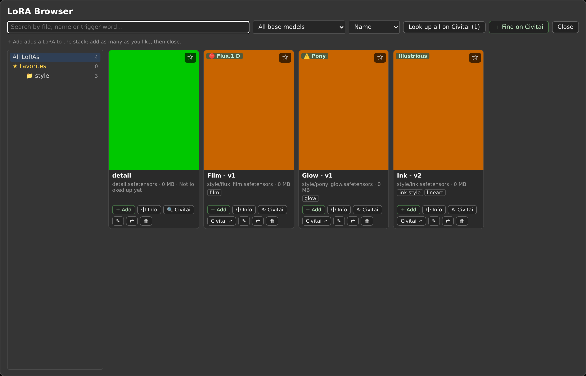

Right-click **Load LoRA** (or another node with a LoRA list), **Random LoRA** or **CLIP Dual Text Encode** and choose **🎴 LoRA Browser**. It shows your LoRAs as cards, with the same Civitai data as [Model info](#model-info):

- a **preview**: an image saved next to the LoRA (`name.preview.png`, `name.png`, `.jpg`, `.webp`, as Civitai Helper and LoRA Manager save them) or else the first Civitai image (blurred if Civitai rates it R or higher, until clicked);
- the **name** (yours from Model info, or the Civitai model and version), the file, its size, the **base model** and the **trigger words** (click one to copy it; your own trigger words from Model info come first);
- from the model's Civitai page: 👍 likes, ⬇ downloads, ⚡ tips and 💬 comments, **🆕 v3** when a newer version than yours is out (it links to that version), the creator and the date of the newest version, and the **tags** (a click on one shows only the LoRAs with that tag, a second click shows all again);
- **batch actions**: Ctrl+click (⌘ on a Mac) picks cards, Shift+click picks every card between the last picked one and this one, and **☐ Select** lets plain clicks pick. The bar above the cards then works on all picked ones: **★ Star**, **☆ Unstar**, **⇄ Move…**, **🗑 Delete** (one confirmation), **Pick all shown** (the search and filters apply), **✕ Clear** (or Escape). Dragging a picked card onto a folder moves every picked one. Opened from LoRA Stack's *＋ Add LoRA*, **+ Add all** adds the picked LoRAs as rows. Each file is done in turn; any that fail are named at the end, the others are done;
- **☆ favorites**: the star on a card's picture makes it a favorite (★), and **★ Favorites** under *All LoRAs* in the tree shows only them. The star is kept in the model's Model info on the server, so it is there in every browser and goes with the file when it is renamed, moved or deleted. The Checkpoint and Diffusion Model Browsers have favorites too;
- a **folder tree** with the number of LoRAs in each folder (subfolders start closed: **▸** opens one, a click on the name shows that folder's LoRAs; **Expand all** / **Collapse all**; the browser remembers which folders are open, and opens the tree to the folder a Random loader uses), a **search** box (file, name, trigger words, tags or creator), a **base model** filter (SDXL, Pony, Illustrious…), a **tag** filter (the tags of the LoRAs looked up, with how many have each) and sorting by name, newest file, base model, most downloaded, most liked or most recently updated on Civitai.

What a card's button does depends on where the browser was opened:

| Opened from | Button | What it does |
|---|---|---|
| Load LoRA and other LoRA loaders | **Use** | Puts the LoRA in the node's LoRA list. The current one is marked *In use*. |
| Random LoRA | **Use folder** (in the tree) | Makes Random LoRA pick from that folder. |
| CLIP Dual Text Encode | **+ Triggers** | Inserts the LoRA's trigger words where the cursor was last in the positive or negative prompt, like the Wildcard Browser. |

The browser only shows what is already known, so it opens at once even with hundreds of LoRAs. **🔍 Civitai** on a card computes that file's hash and asks Civitai; **Look up all on Civitai** does it for every LoRA not looked up yet, one by one (click again to stop). **🛈 Info** opens the Model info dialog, where you can add your own name and trigger words; the card shows them when the dialog closes.

#### Managing model files: find on Civitai, rename, delete

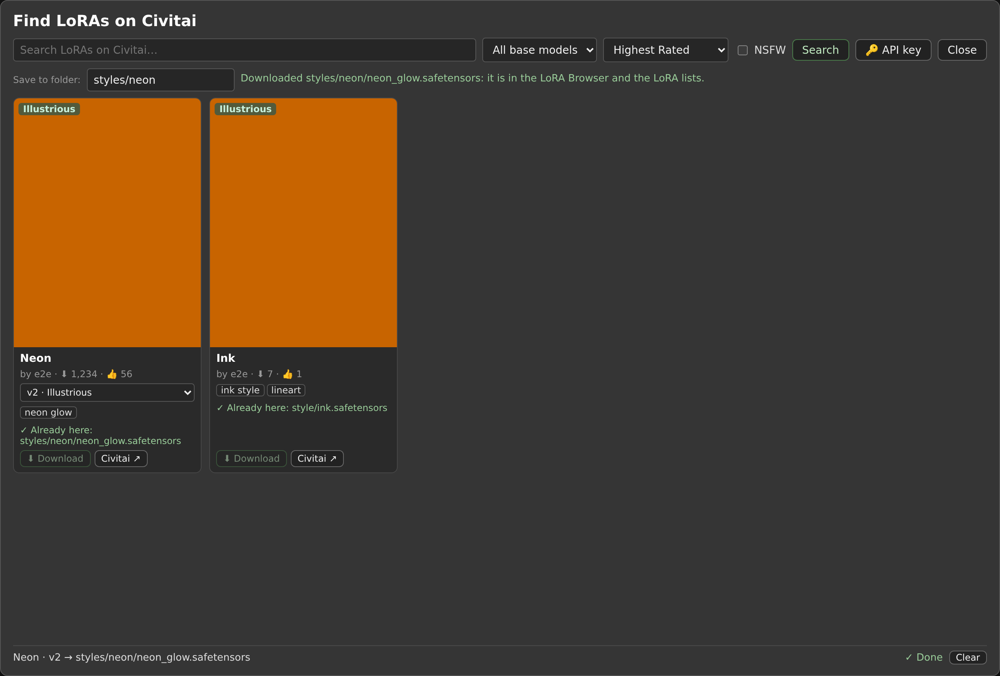

The LoRA, [Checkpoint](#checkpoint-browser) and [Diffusion Model](#diffusion-model-browser) Browsers also manage the files themselves:

- **＋ Find on Civitai** searches Civitai: LoRAs (also LoCon and DoRA) in the LoRA Browser, Checkpoints in the other two: words, a base model, *Highest Rated*, *Most Downloaded* or *Newest*, and NSFW off by default. A card shows the images (R and up blurred until clicked), the creator, downloads and likes, the trigger words, and a list of the versions with their base model. A version you already have, by its sha256 or by its file name, is marked *✓ Already here*. When the browser was opened from a node with a model connected (LoRA Stack), the search starts on that base model.
- **⬇ Download** saves the version's file in `models/loras` (`models/checkpoints`, `models/diffusion_models`), or in the folder typed in *Save to folder* (`styles/neon`; it is made if needed). The download is written as `name.part` and checked against Civitai's sha256 before it gets its name, so a stopped or damaged download never shows up as a LoRA. It also saves the Civitai data (so Model info and the card know it at once, no hashing) and the first image as `name.preview.png`. The progress is shown at the bottom, with **Stop**; up to 3 downloads run at a time, and they go on when the dialog is closed. The LoRA lists of the nodes get the new file without a restart.
- **🔑 API key**: some LoRAs (early access, or ones that need a login) download only with your Civitai API key (Civitai → Account settings → API keys). It is saved in `ComfyUI/user/DiceForge/civitai.json`, or set `CIVITAI_API_KEY` in ComfyUI's environment instead. It is only sent to civitai.com, never to the images' servers, and never shown again in the browser.
- **⇄** on a card moves the file to another folder: pick one of the folders (or the top folder), or type a new one (made by the move). Dragging a card onto a folder in the tree does the same (onto *All …* for the top folder). Its preview, info files and Model info go with it, as with ✎.
- **✎** on a card renames or moves the LoRA (`styles/ink v2` moves it to `styles`; the extension stays). Its preview, other info files next to it (`.civitai.info`, `.metadata.json`) and its Model info (notes, Civitai data, hash) go with it. A name that is taken is refused. A Load LoRA node the browser was opened from follows the file to its new name; other workflows that use the old name need the new one.
- **🗑** deletes the LoRA, with its preview, info files and Model info, after a confirmation. Folders left empty go too.

#### Checkpoint Browser

The same browser for checkpoints: right-click **Load Checkpoint** (or another node with a checkpoint list) or **Random Checkpoint** and choose **🗃️ Checkpoint Browser**. Cards, previews, folder tree, search, base model filter, sorting and Civitai lookups work as in the [LoRA Browser](#lora-browser).

| Opened from | Button | What it does |
|---|---|---|
| Load Checkpoint and other checkpoint loaders | **Use** | Puts the checkpoint in the node's list. The current one is marked *In use*. |
| Random Checkpoint | **Use folder** (in the tree) | Makes Random Checkpoint pick from that folder. |

**＋ Find on Civitai**, **✎** and **🗑** work as in the LoRA Browser ([Managing model files](#managing-model-files-find-on-civitai-rename-delete)): the search shows Civitai's Checkpoints.

Your **recommended settings** from Model info (steps, CFG, sampler…) are shown on the card (⚙), so you can see how to use a checkpoint while picking it; LoRA cards show them too. A checkpoint is several GB, so its first Civitai lookup takes longer (the hash is read from the whole file); the browser stays usable while **Look up all** runs, and closing it stops the lookups (the ones already done are kept).

#### Diffusion Model Browser

The same browser for diffusion models (`models/diffusion_models`, and the older `models/unet`): Flux, Qwen, Wan and other models that come without their text encoders and VAE. Right-click **Load Diffusion Model**, **Load Diffusion Model + CLIP** (or another node with a diffusion model list) or **Random Diffusion Model** and choose **🧊 Diffusion Model Browser**.

| Opened from | Button | What it does |
|---|---|---|
| Load Diffusion Model, Load Diffusion Model + CLIP and other diffusion model loaders | **Use** | Puts the model in the node's `unet_name` list. The current one is marked *In use*. |
| Random Diffusion Model | **Use folder** (in the tree) | Makes Random Diffusion Model pick from that folder. |

Cards, previews, folder tree, search, filters, Civitai lookups, **＋ Find on Civitai**, **✎** and **🗑** work as in the other browsers. On **Load Diffusion Model + CLIP**, the right-click menu also has a **🔤 Text Encoder Browser** for each of its text encoder lists (`clip_name1`, `clip_name2`). Civitai has no model type of its own for diffusion models: they are *Checkpoints* there, so the search shows Checkpoints. Pick a version whose file is the diffusion model alone (often marked fp8, unet or "model only"); a full checkpoint (with its text encoder and VAE) belongs in the Checkpoint Browser. Downloads go to `models/diffusion_models`, even where ComfyUI also has the older `models/unet`.

#### Text Encoder Browser and VAE Browser

The same browser for the files of `models/text_encoders` and `models/vae`. Right-click **Load CLIP**, **DualCLIPLoader**, **Load Diffusion Model + CLIP** (one entry per text encoder list) and choose **🔤 Text Encoder Browser**, or **Load VAE**, **Load VAE + Decode + Save** and **Random VAE** for **🎨 VAE Browser**. **Use** puts the file in the list the browser was opened for; **Use folder** in the tree sets Random VAE's folder. Cards, folders, search, favorites, Model info, **✎**, **⇄** and **🗑** work as in the other browsers. **＋ Find on Civitai** is in the VAE Browser only: Civitai has no model type for text encoders.

The browsers are offered for every node whose list holds model files, whatever the node pack. They also work when another extension keeps the list in its own form, or when ComfyUI's experimental Asset API replaces the list: then the current file is enough, as for Model info.

## Utility nodes

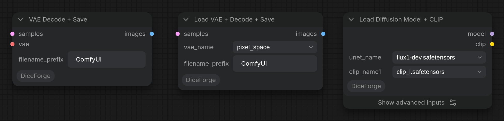

- **Load VAE + Decode + Save** (`utils`, `DiceForge/load_vae_decode_save.py`): Load VAE, VAE Decode and Save Image in one node. It decodes the latent with the chosen VAE and saves PNG files with the workflow, like Save Image, and passes the images on. The VAE stays loaded between runs while its name stays the same. The `vae` output passes the VAE on (for VAE Encode in a hires fix or inpaint).
- **VAE Decode + Save** (`utils`): the same without Load VAE, with the VAE from its `vae` input (the VAE of Load Checkpoint, Load VAE, Random VAE…).
- `image_output` decides what both do with the images, as in Easy-Use's samplers: *Hide* (only passed on), *Preview* (shown, not saved), *Save* (saved and shown, the default) or *Hide&Save* (saved, not shown).
- **Load Diffusion Model + CLIP** (`utils`, `DiceForge/load_diffusion_model_clip.py`): Load Diffusion Model and Load CLIP in one node, for models that come as separate files (Flux, Anima, Qwen-Image...): the model from `models/diffusion_models` and one text encoder, or two like DualCLIPLoader when `clip_name2` is set. The CLIP type is checked against the number of files before anything loads.

## Development

### Tests

Two test suites, next to `DiceForge` (not copied into ComfyUI). Both need a ComfyUI checkout with its Python packages installed, and never touch your own ComfyUI folders.

#### Unit tests

The `tests` folder has unit tests for every node and server route: seed modes, prompt syntax and wildcards (txt, yaml, globs, weights, variables, `<lora:>` tags), the resolution nodes (including the preview's rounding against the node's), the random nodes and loaders, LoRA Stack (strengths, groups, trigger words, presets), Model info, the model browsers and model files (Civitai search and downloads, rename, move, delete), KSampler presets, prompt styles, the tag lists and Tag Browser, Danbooru Tag Enhancer (with a stand-in for Danbooru), XY Plot, Variation Seed, both hires fixes, VAE Decode + Save, Dice Grid (keeping cells) and the release script.

The `test_properties_*.py` files check rules that must hold for *any* input, with [Hypothesis](https://hypothesis.readthedocs.io) generating hundreds of inputs per rule: every pick comes from its options and is reproducible from the seed; deck deals every option once per round (also within one prompt, across the end of a round); `combinations` lists every possible prompt exactly once; locks, variables, escapes, comments and the comma and space clean-up keep their promises in every seed mode; any text (fuzzed prompt syntax, any Unicode) resolves or stops with a clear error, quickly; every size is a positive multiple of `multiple` and keeps what `rescale` promises; Random Int, Float and Sampler stay in their range; any LoRA Stack data runs or is refused clearly; Dice Grid renders any labels; and no file name from a request reaches outside its folder. `test_robustness.py` damages things on purpose: a seed memory, grid manifest, model info or preset file that is broken, wildcard files in other encodings or deleted while indexed, junk requests to every route (always a 4xx answer, never a server error), many threads at once, the same picks in every Python process, and the frontend's `__` autocomplete knowing the same letters as the server.

They run inside a real ComfyUI checkout, on the CPU, with [pytest](https://pytest.org) and Hypothesis:

```sh
cd ComfyUI-DiceForge
pip install pytest hypothesis   # in ComfyUI's Python environment
COMFYUI_PATH=/path/to/ComfyUI python -m pytest tests
```

`HYPOTHESIS_PROFILE` picks how hard the property tests search: `default` (up to a few hundred inputs per rule, fewer for the slow ones, different ones each run; the whole suite takes about a minute), `ci` (the same inputs every run, as GitHub Actions uses, so a red run is a real bug and not bad luck) or `thorough` (15 times as many, for a long hunt). A failing rule prints the smallest input that breaks it.

Without `COMFYUI_PATH`, the tests look for `ComfyUI` next to this repository. They never touch your ComfyUI: seed memory, model info, presets, grids and saved images go to a temporary folder that is deleted afterwards, the model and wildcard files they need are made in temporary folders, the core model loaders and LoRA patching are replaced by stand-ins (no real model is loaded), and Civitai, the tag lists and Danbooru are never contacted. The checks against the frontend (the preview's rounding, the autocomplete's letters) run when [Node.js](https://nodejs.org) is installed and are skipped otherwise.

#### End-to-end tests

The `e2e` folder has end-to-end tests with [Playwright](https://playwright.dev): they start a real ComfyUI with DiceForge and drive it like a user would.

- **Workflows** (`api.spec.js`, no browser): workflows queued through ComfyUI's own queue, as the Run button does: every node is loaded, CLIP Dual Text Encode fills in wildcards, yaml keys, weights and variables; deck and combinations deal every option over runs; the same inputs come from ComfyUI's cache until a wildcard file changes; shuffle remembers between runs; the resolution nodes make latents of the right size; VAE Decode + Save writes PNG files with the workflow; Dice Grid saves a finished grid; Random Image loads a folder; Random Sampler's outputs are accepted by KSampler; and the server routes of the Wildcard Browser, Model info, the model browsers and LoRA Stack presets.
- **Robustness on the real server** (`robustness.spec.js`, no browser): junk HTTP requests to every DiceForge route (always a 4xx answer, never a server error) and names that try to reach outside DiceForge's folders (`../`, absolute paths, encoded slashes: nothing read, written or deleted outside); an error in a node stops only that prompt, with a clear message, and the next prompt runs; prompts with invalid inputs are refused by ComfyUI; the seed memory file damaged or replaced while ComfyUI runs, damaged wildcard (BOM, other encodings, broken yaml), model info, preset and Dice Grid files; many prompts queued at once; every seed mode through the queue (the same seed from ComfyUI's cache with the same prompt, mutate changing one choice per new seed, combinations listing every prompt once); text in any script and emoji; a 50 000-line wildcard; Random Chaos keeping its orientation and the side `rescale` sets.
- **Browser** (`ui.spec.js`, in both node designs, Nodes 2.0 and classic): every node can be added; the resolution preview; CLIP Dual Text Encode's preview, history, syntax highlighting, `__` and `<lora:` autocomplete, tag autocomplete, Tag Browser and prompt styles; the Wildcard Browser; Model info and **Use these settings**; every model browser (Civitai search and downloads, batch actions, favorites, moving files); LoRA Stack (adding from the browser, 🎲, groups, 🏷 trigger words, the base model marks, presets, reloading the workflow); KSampler presets; XY Plot's queue button; Dice Grid's kept cells; Random Image's and Danbooru Tag Enhancer's previews; a workflow run from the page; and node heights with advanced inputs. `ui-robustness.spec.js`, in both designs too: every DiceForge node keeps every value through saving and loading a workflow twice; damaged workflows (too few, too many or wrong values, junk LoRA Stack data) open without breaking the page; copied nodes are independent; after a failed run the page keeps working; the Wildcard Browser marks an unreadable file; the autocomplete with the mouse, in the negative prompt and after another wildcard; random series of changes to both resolution nodes, after which the preview must show exactly the size the run makes; 64 nodes at once. Any error in the page fails the test.

```sh
cd ComfyUI-DiceForge/e2e
npm install
npx playwright install chromium
COMFYUI_PATH=/path/to/ComfyUI npm test          # PowerShell: $env:COMFYUI_PATH="C:\ComfyUI"; npm test
```

`e2e/server.js` makes a temporary ComfyUI base folder (`--base-directory`, in the system temp folder, deleted afterwards) with a link to this repository's `DiceForge` folder and small test files (stand-in model files, wildcards, images), starts a small stand-in for Civitai, the tag lists and Danbooru on the local machine (the tests never go online; DiceForge reads their addresses from `DICEFORGE_CIVITAI_URL`, `DICEFORGE_CIVITAI_API`, `DICEFORGE_TAGS_URL` and `DICEFORGE_DANBOORU_URL`), and runs ComfyUI on the CPU at port 8199. `COMFYUI_PYTHON` picks the Python that runs ComfyUI (by default its `venv`/`.venv`, the portable build's `python_embeded`, or `python` from the PATH), `DICEFORGE_E2E_PORT` another port (the Civitai stand-in uses the next one). `npm run test:api` runs only the tests without a browser. A run takes about 6 minutes; after a failure, `npx playwright show-report report` shows screenshots and traces.

The screenshots in this README (`docs/images`) are made by `e2e/screenshots.spec.js` in the same ComfyUI with the same test files. It is skipped in a normal run; to make them again after a change to the nodes:

```bash
cd ComfyUI-DiceForge/e2e
DICEFORGE_SCREENSHOTS=1 npx playwright test screenshots.spec.js
```

#### On GitHub

GitHub Actions (`.github/workflows/tests.yml`) checks the workflow files with [actionlint](https://github.com/rhysd/actionlint) and runs both suites on every push to `main` and every pull request, on Linux and the CPU, with the ComfyUI version the tests were written with (pinned in the workflow). A weekly run tests against ComfyUI's latest `master`, to see early when a ComfyUI update breaks something, and *Run workflow* on the Actions page can test any ComfyUI commit, branch or tag. When end-to-end tests fail, the run keeps the Playwright report (screenshots and traces) as the `playwright-report` artifact.

Dependabot (`.github/dependabot.yml`) opens a weekly pull request when a GitHub Action of the workflows or an end-to-end test tool has a new version; the tests run on it like on any pull request.

#### Code analysis (SonarQube Cloud)

The unit tests also measure which lines of `DiceForge` they run (pytest-cov, `coverage.xml`), and GitHub Actions sends the code and that coverage to [SonarQube Cloud](https://sonarcloud.io) (settings in `sonar-project.properties`), which reports bugs, vulnerabilities, duplications and coverage for every push and pull request. To set it up in a fork: import the repository in your SonarQube Cloud organization, turn off *Automatic Analysis* (Administration → Analysis Method), put your organization and project key in `sonar-project.properties`, and add a token from My Account → Security as the `SONAR_TOKEN` secret of the GitHub repository. Without the secret the scan step is skipped. After the scan, `.github/scripts/sonar_summary.py` puts the Quality Gate, the measures, every open issue and every security hotspot on the run's summary page on GitHub (and in its log), so they can be read without opening SonarQube Cloud. Locally: `COMFYUI_PATH=/path/to/ComfyUI python -m pytest tests --cov=DiceForge --cov-report=term`.

### Releasing

1. Under `## [Unreleased]` in [CHANGELOG.md](CHANGELOG.md), list what changed; then rename it to `## [x.y.z] - date` (with a new empty `[Unreleased]` above it) and set the same version in `pyproject.toml` and `DiceForge/__init__.py` (`tests/test_release.py` checks they agree).
2. Commit, push, and when the tests are green, tag it: `git tag vx.y.z && git push origin vx.y.z`.
3. The *Release* workflow runs the tests again, makes the GitHub release with that version's changelog section as its notes, and publishes the pack to the ComfyUI Registry.

Publishing to the Registry needs, once: a publisher on [registry.comfy.org](https://registry.comfy.org) with the `PublisherId` of `pyproject.toml` (`deduxonline`), an API key of that publisher, and that key as the repository secret `REGISTRY_ACCESS_TOKEN` (GitHub → Settings → Secrets and variables → Actions). Without the secret, the release is still made on GitHub and the workflow warns that the Registry step was skipped.
